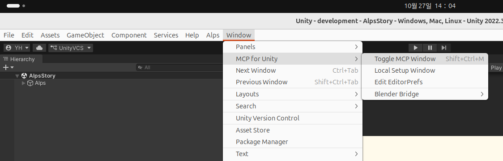
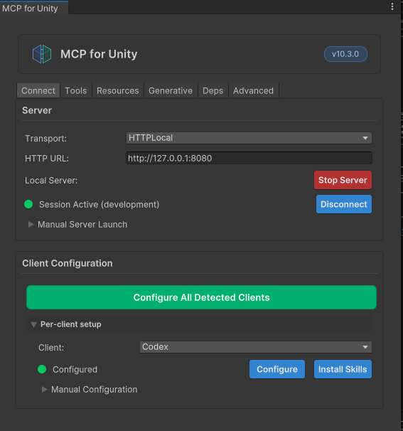
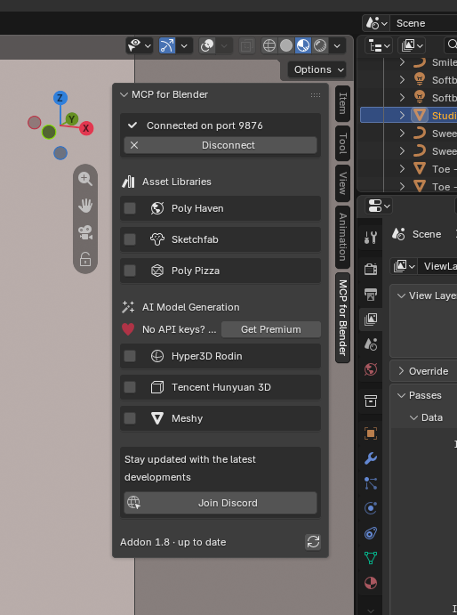
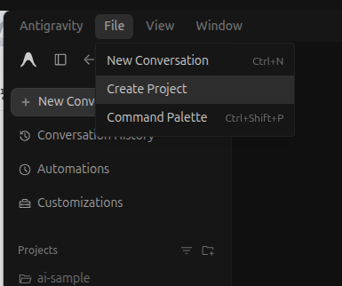
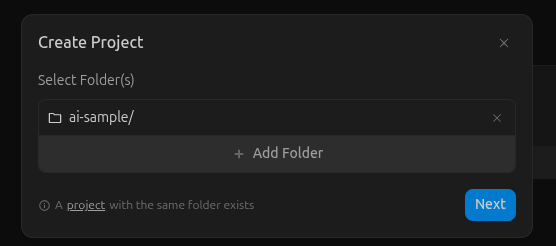
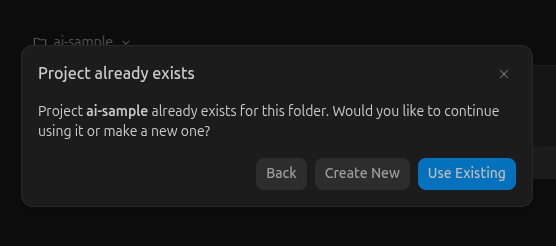
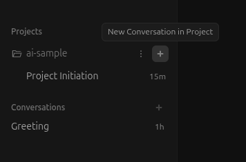
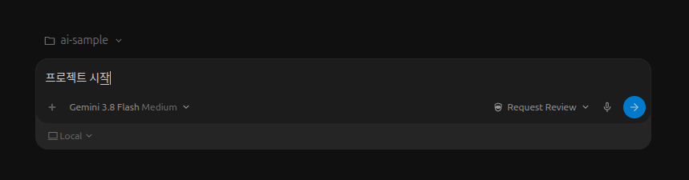
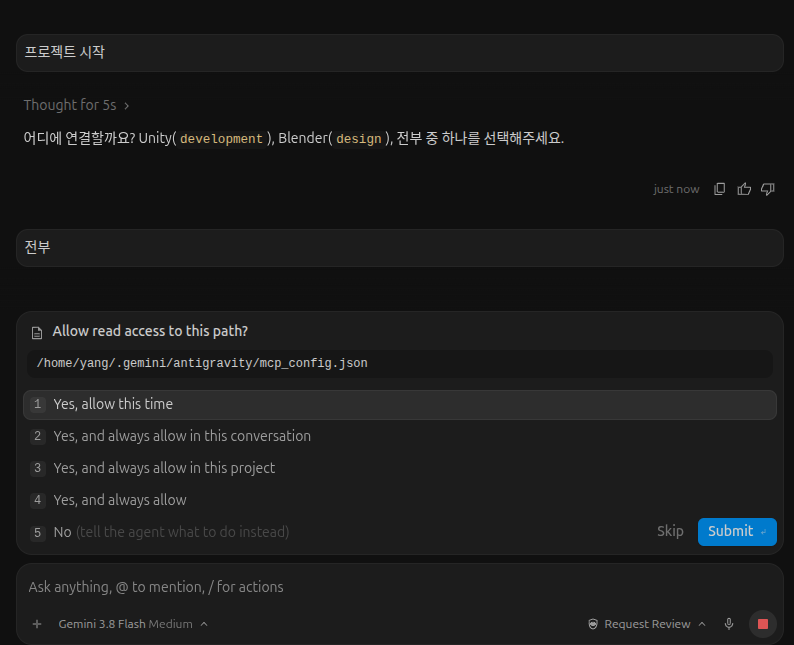

# Unity + Blender AI 작업 공간

AI tool(`antigravity`)로 Unity와 Blender를 연결해 작업합니다. 기본 샘플로 unity 2022.3.3 및 blender 5.23 에 mcp 연결을 한 상태 입니다.

## 기본 준비사항

- unity, blender, git, ai tool(antigravity) 을 설치한다.
- 개발만 하거나, 디자인만 하려면 unity, blender 중 하나를 생략해도 무방하다.
- 추가적으로 uv 툴을 설치한다. [uv 설치 안내](#uv-설치-안내)

## 폴더

- `development/`: Unity 프로젝트. Unity Hub에서 이 폴더를 엽니다.
- `design/`: Blender 와 ai 연결한 샘플.
- 각 디렉토리에 현재 샘플을 지우고 작업하던 항목들을 옮겨서 올려 사용 가능합니다.

## 접속 및 동작 준비 시작

### uv 설치

[uv 설치하기 참고자료](https://docs.astral.sh/uv/getting-started/installation/)

윈도우 에서는
- Win 키를 누르거나 화면 아래 시작 버튼을 클릭합니다.
- PowerShell 또는 Windows PowerShell을 입력합니다.
- 검색된 Windows PowerShell을 선택해 실행합니다.
- powershell 에서는 다음 명령어를 입력한다.
```powershell
winget install --id astral-sh.uv -e
```

MacOS 에서는 
- 화면 아래쪽 바에서 로켓 모양 아이콘인 Launchpad(런처패드)를 클릭합니다.
- 맨 위 검색창에 `termianl` 이라고 입력해 터미널을앱을 실행합니다.
- 다음의 명령어 입력하여 설치합니다.
```
curl -LsSf https://astral.sh/uv/install.sh | sh
```

### unity
1. Unity 프로젝트를 열고 패키지 로딩을 기다립니다.
2. **Window > MCP for Unity > Toggle MCP Window** 에 들어갑니다.

   

3. **Transport**는 `HTTPLocal`, **HTTP URL**은 `http://127.0.0.1:8080`으로 두고 **Start Server → Connect** 후 `Session Active`를 확인합니다. 사용하는 CLI는 **Client Configuration**에서 **Configure**를 누릅니다.

   

### blender
1. Blender에서 `design/work.blend`를 열고 로딩을 기다립니다.
2. 오른쪽 바에서 MCP 애드온 서버를 확인합니다.

   

3. 가장 상단에서 Connected ... 라고 되어있으면 연결된 상태입니다.
4. 연결이 되지 않아 있으면, Connect to MCP Server 버튼을 눌러 Connected 상태가 되는것을 확인합니다.


### ai tool (`Antigravity`)

1. Antigravity 를 설치하여 준비합니다.

### 기본 주소:

- Unity: `http://localhost:8080/mcp`
- Blender: `http://127.0.0.1:9876` (TCP, HTTP 주소 아님)

## 작업 시작

### AI tool(`antigravity`) 시작 및 프로젝트 설정

저장소 루트에서 ai tool (`antigravity`) 을 실행하고 작업을 요청합니다. <br>
해당 git 에서 다운받은 디렉토리에 프로젝트를 시작한다.







(참고사항)
- 루트에서 시작: Unity / Blender 전부 제어
- `development/`에서 시작: Unity 제어.
- `design/`에서 시작: Blender 제어.

### unity, blender 연결 

- ai tool (`antigravity`) 에서 대화를 시작한다.





- 대화에 맞추어서 unity, blender 에 연결한다.
- 첫 대화라면 그에 맞춘 mcp 를 자동으로 설치하도록 된다. 모두 allow 하여 설치 및 연결을 승인한다.



- 두번째 접속 이후라면 mcp 는 이미 설치된 상태라서 unity 혹은 blender 에 연결을 기다힌다.
- `준비되었습니다.` 가 나오면 연결 확인 완료입니다. 
- `실패했습니다.` 가 나오면 연결이 최소되었습니다. 취소된 이유가 나오는데, 나오는 이유에 맞추어 연결을 조정합니다. 
- 준비가 된 이후에는 개발을 진행합니다.

## 개발/디자인 시작

이후에는 claude code 및 codex 통해 대화형으로 AI 기능을 활용할 수 있습니다.<br>
이를테면 "blender 에서 귀여운 곰인형 만들어줘", "doll.fbx 가 하늘에서 떨어지는 샘플 scene 만들어줘" 등 으로 진행도 가능합니다. <br>
이때 ai 는 unity, blender 를 직접 제어하며 3D 캐릭터를 만들거나 unity 기능을 만들어 직접 디자인/개발 작업을 진행할 수 있습니다.


# 처음부터 MCP 설정하기

같은 PC에서 Unity·Blender와 CLI를 구성하는 기준입니다. 이미 설치했다면 서버 시작과 연결 확인만 하면 됩니다. 아래 Claude는 **Claude Code** 기준입니다.

## 1. 준비

- Unity, Blender, 사용할 CLI(Codex 또는 Claude Code)를 설치하고 로그인합니다.
- 현재는 Codex, Claude Code 기준이었는데 qwen code, glm 등을 활용해도 유사하게 사용 가능합니다.
- 추가적으로 uv 툴을 설치한다.

## 2. 프로그램 설치

### uv 설치 안내

[uv 설치하기 참고자료](https://docs.astral.sh/uv/getting-started/installation/)

#### MacOS, linux (혹은 window WSL2)

다음중 하나를 선택해서 설치한다.

curl 명령어 활용
```
curl -LsSf https://astral.sh/uv/install.sh | sh
```

wget 명령어 활용
```
wget -qO- https://astral.sh/uv/install.sh | sh
```

pip 명령어 활용
```
pip install 활용
```

#### Windows

윈도우 에서는 다음의 항목중 하나를 실행한다.

실행창을 검색하여 powershell 혹은 cmd 을 실행하여 다음을 실행한다.
```powershell
winget install --id astral-sh.uv -e
```

pip 명령어 활용
```
pip install 활용
```

## 3. MCP 설정

### 1. Unity: 패키지 설치 → 서버 시작

1. Unity Hub에서 기존 프로젝트를 열거나 새 프로젝트를 만듭니다.
2. **Window > Package Manager > + > Add package from git URL…**을 선택합니다.
3. 아래 주소를 붙여 넣고 **Add**를 누른 뒤 설치·컴파일을 기다립니다.

   ```text
   https://github.com/CoplayDev/unity-mcp.git?path=/MCPForUnity#main
   ```

4. **Window > MCP for Unity**를 엽니다. 연결 방식을 **HTTP / Local**로 두고 **HTTP URL**을 `http://localhost:8080`으로 설정합니다.
5. **Start Server**로 HTTP 서버를 실행한 뒤 **Connect**로 Unity를 연결합니다. 버전에 따라 연결 버튼이 **Start Session** 또는 Bridge 시작으로 표시될 수 있습니다.
6. 서버 실행·Unity 연결 상태를 확인합니다. CLI에 등록할 주소는 끝에 `/mcp`를 붙인 **`http://localhost:8080/mcp`**입니다.

설치 기준: [MCP for Unity](https://github.com/CoplayDev/unity-mcp). `#main`은 최신 코드를 설치하므로 메뉴 이름은 버전에 따라 조금 다를 수 있습니다.

### 2. Blender: 애드온 설치 → 서버 시작

1. 다음 중 하나를 내려받습니다.
   - Blender 5.1 이상: [Blender Lab MCP v1.0.3 (mcp-1.0.3.zip)](https://projects.blender.org/lab/blender_mcp/releases/download/v1.0.3/mcp-1.0.3.zip?repository=https%3A%2F%2Flab.blender.org%2F&blender_version_min=5.1.0) — zip 그대로 사용합니다.
   - 그 외: [MCP for Blender의 addon.py](https://github.com/ahujasid/mcp-for-blender/blob/main/addon.py)를 열고 **Download raw file**로 저장합니다.
2. Blender에서 **Edit > Preferences > Add-ons > 오른쪽 위 메뉴 > Install from Disk…**로 내려받은 파일(`mcp-1.0.3.zip` 또는 `addon.py`)을 선택합니다. 구버전은 **Install…** 버튼을 사용합니다.
3. 설치된 **MCP for Blender**(구버전: **Blender MCP**)를 체크해 활성화합니다.
4. 작업할 `.blend` 파일을 열고, **3D Viewport 위에 마우스를 둔 상태로 `N`**을 누릅니다.
5. 오른쪽 **MCP for Blender / BlenderMCP** 탭에서 포트 `9876`을 확인하고 **Start MCP Server**(구버전: **Connect to Claude**)를 누릅니다. 이미 실행 중이면 그대로 둡니다.

`127.0.0.1:9876`은 애드온의 **TCP 포트**입니다. CLI는 아래의 `uvx` 서버를 통해 접속합니다. [설치 안내](https://github.com/ahujasid/mcp-for-blender#installing-the-blender-addon)

### 3. Codex / Claude Code: MCP 등록

저장소 루트의 터미널에서 **사용할 CLI 명령만** 실행합니다. MCP 기능은 CLI에 내장되어 있으므로 별도 확장 설치 없이 서버를 등록하면 됩니다.

**Codex**

```bash
codex mcp add unityMCP --url http://localhost:8080/mcp
codex mcp add blender -- uvx mcp-for-blender
```

**Claude Code**

```bash
claude mcp add --transport http --scope user unityMCP http://localhost:8080/mcp
claude mcp add --transport stdio --scope user blender -- uvx mcp-for-blender
```

Blender의 새 설치용 패키지명은 `mcp-for-blender`입니다. 기존 `uvx blender-mcp` 설정도 지원됩니다

## 4. (Optional) 사용하기 편항 항목들 설치

### 1. MCP 참고사항

Blender의 새 설치용 패키지명은 `mcp-for-blender`입니다. 기존 `uvx blender-mcp` 설정도 지원됩니다.

등록 후 CLI를 새로 실행하고 **“Unity와 Blender의 현재 씬 이름을 조회해줘”**처럼 조회를 하여 확인할 수 있습니다.

명령 참고: [Codex MCP](https://developers.openai.com/codex/mcp), [Claude Code MCP](https://code.claude.com/docs/en/mcp).


### 2. 기본 포트 변경하기

**Unity: 8080 → 8081 예시**>

1. **Window > MCP for Unity**에서 Unity 연결과 HTTP 서버를 중지합니다.
2. **HTTP URL**을 `http://localhost:8081`로 바꾸고 **Start Server → Connect**를 다시 누릅니다.
3. 사용하는 CLI에서 기존 등록을 지우고 새 주소로 등록합니다.

```bash
# Codex 사용 시
codex mcp remove unityMCP
codex mcp add unityMCP --url http://localhost:8081/mcp

# Claude Code 사용 시
claude mcp remove --scope user unityMCP
claude mcp add --transport http --scope user unityMCP http://localhost:8081/mcp
```

**Blender: 9876 → 9877 예시**

1. `N > MCP for Blender / BlenderMCP`에서 서버를 중지합니다.
2. **Port**를 `9877`로 바꾸고 서버를 다시 시작합니다.
3. CLI 등록에도 같은 포트를 지정합니다. `BLENDER_PORT`는 `uvx` 서버가 Blender에 접속할 때 사용할 값입니다.

```bash
# Codex 사용 시
codex mcp remove blender
codex mcp add blender --env BLENDER_PORT=9877 -- uvx mcp-for-blender

# Claude Code 사용 시
claude mcp remove --scope user blender
claude mcp add --transport stdio --scope user --env BLENDER_PORT=9877 blender -- uvx mcp-for-blender
```

cluade code 는 설정후 재시작 해야 합니다.<br>
포트 설정 근거: [서버 연결 설정](https://github.com/ahujasid/mcp-for-blender#environment-variables).

----

# 자주 발생하는 문제 및 해결

- 도구 없음: MCP 등록·서버 실행 상태 확인 후 CLI 세션 재시작.
- Unity 응답 없음: HTTP 서버·Bridge·Console 오류 확인.
- Blender 응답 없음: 애드온 활성화·서버 시작·호스트와 포트 확인.
- 다른 프로젝트 연결: Unity `projectRoot` 또는 Blender 파일의 실제 경로 확인.
- 주소 변경: MCP 설정도 변경하고 새 세션에서 재검증.
