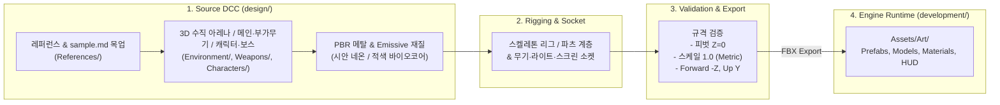
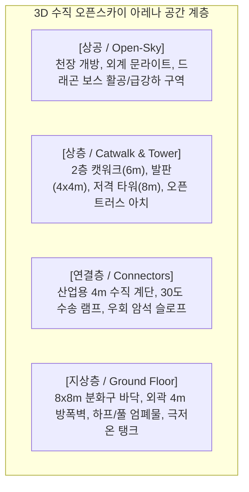
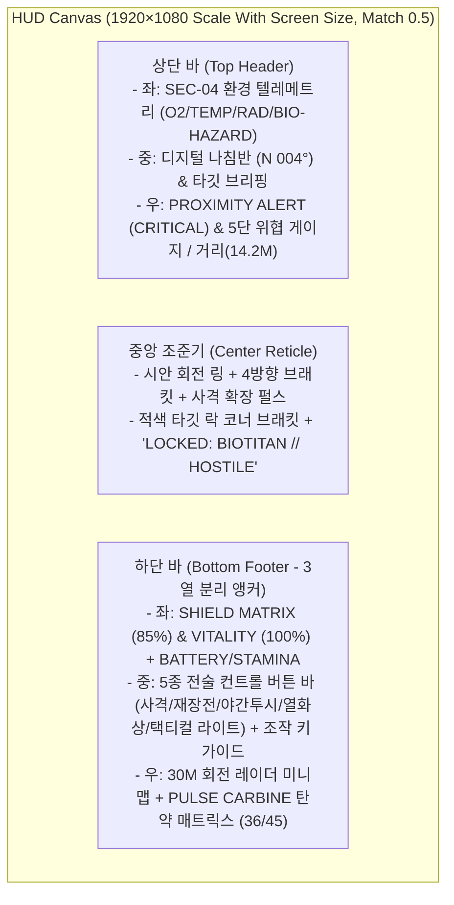

# 3D 게임 아트 파이프라인 아키텍처 (`design/ARCHITECTURE.md`)

본 문서는 **PROJECT: TARTARUS (`sample.md` 기반 다크 SF 바이오 호러 FPS)**의 Blender 3D DCC 도구와 Unity 게임 엔진 간 **아트 에셋 파이프라인 아키텍처**, **3D 다층 수직 오픈스카이 아레나 규격**, **크리처/무기 소켓 체계**, **조명/투시 모드 및 HUD 레이아웃 규격**을 정의합니다.

---

## 1. 아트 파이프라인 아키텍처 (단방향 흐름)

에셋의 품질 유지와 형상 관리(Version Control)를 위해 **Source(제작/가공)**와 **Runtime(엔진 실행)**을 엄격히 분리합니다.



---

## 2. 3D 다층 수직 오픈스카이 아레나 아키텍처 (`SEC-04 EXCAVATION CRATER`)

기존의 2D 평면 복도 구성을 탈피하여, 상공이 열린 거대 발굴 분화구 내에서 **지상층, 2층 캣워크, 저격 타워, 경사로, 계단, 공중 보스 비행 공간**이 유기적으로 맞물리는 **3D 수직성(Verticality) 아키텍처**를 적용합니다.



### 1) 피벗(Pivot) 및 스냅 원칙
- **모든 환경/지형/캣워크/엄폐물 에셋**: 지면과 맞닿는 하단 바닥면 중앙(`X=0, Y=0, Z=0`)에 피벗 고정.
- **모듈러 이음새**: 4m 단위 그리드 및 2m 캣워크 규격으로 정밀 스냅되도록 버텍스 정렬.

### 2) 공간 조명 및 포스트프로세싱 아키텍처
- **Open-Sky Moonlight & Fog**: 개방된 상공에서 차갑게 쏟아지는 디렉셔널 문라이트(Moonlight)와 바닥 부근에 깔리는 `#020408` 딥 네이비 지수 안개(`FogExp2`, 밀도 `0.045`).
- **Emergency Flickering Red Light**: 분화구 위험 구역 및 보스 강하 지점에 적색 비상 경보등(`#ff1e1e`) 불규칙 점멸 연출.
- **Neon Cyan Accent Light**: 캣워크 난간 및 램프 가이드라인에 시안 네온(`#06b6d4`)을 배치하여 어둠 속에서도 3D 고저차와 동선이 뚜렷하게 식별되도록 지원.
- **Tactical Vision Modes (투시 필터)**:
  - **기본 모드**: ACES Filmic 톤매핑 + 가장자리 비네트(Vignette) + 미세 스캔라인(Scanline) + 적 근접 시 화면 외곽 적색 경보 테두리(`Alarm Border`) 점멸.
  - **야간투시 (`NVG`)**: 에메랄드 그린 컬러 틴트(`#12ff6e`) 및 안개 색상 다크 그린(`#063311`) 전환.
  - **열화상 (`Thermal`)**: 오렌지-바이올렛 고대비 열원 틴트 및 안개 색상 다크 바이올렛(`#19082b`) 전환, 생체 코어 발광 극대화.

---

## 3. 크리처(`Biotitan`), 캐릭터 & 무기 소켓 아키텍처

### 0) 파일 분리 및 독립 모델링 원칙 (1 Asset = 1 `.blend`)
- **원본 소스 격리**: 하나의 `.blend` 파일에 여러 에셋을 혼재하지 않고, 무기 5종(`design/Weapons/`), 플레이어 5종·몬스터 5종·보스 1종(`design/Characters/`), 환경 모듈(`design/Environment/`)을 **각각 독립 `.blend` 파일로 제작**합니다.
- **고해상도 Tripo 3D & 자동 리깅 파이프라인**: 컨셉 시트(`References/*.png`)에서 무손실 분리한 개별 이미지(`References/Cropped/`) 또는 영문 프롬프트(`TRIPO_PROMPTS.md`)를 이용해 Tripo 3D 4K PBR 모델 및 Auto-Rig(`animate_rig`)를 생성(`scripts/tripo_batch_api.py`)하고, 각 독립 `.blend` 파일 및 [work.blend](file:///home/yang/work/ai-sample/design/work.blend)로 정규화·리깅(`scripts/import_tripo_to_blends.py`, `scripts/rig_tripo_mesh.py`)합니다.

### 1) 결전 보스 메카 `CH_Boss_ArchDreadRaze` (`boss.png` 기준)
`boss.png`의 사이버 드래곤 메카 보스로 아키텍처를 정의합니다.

```text
CH_Boss_ArchDreadRaze (Root)
├── Mech_Dragon_Head        # 기계 바이저 턱 & 뿔
├── Wing_Thrusters_L/R      # 청색 에너지 날개 추진기 (파괴 시 지상 추락 기믹)
├── Chest_Plasma_Core       # 흉부 플라즈마 코어 (주포 충전 시 개방되는 메인 약점)
├── Heavy_Particle_Cannons  # 양 어깨 중합 입자포 쌍발 장치 (충전 중 피격 파괴 가능)
└── Energy_Tail_Spur        # 꼬리 에너지 방출구 (광범위 충격파 시 적색 과열 타깃)
```

### 2) 플레이어 아바타 규격 (`avartar.png` 기준 5종 클래스)
- **메인 (나의 모습)**: `SK_Player_AssaultOutrider` (어썰트 아웃라이더 - 화이트/오렌지 슈트, 스캔 바이저, 어깨 미사일 포드)
- 배리에이션: `CH_Avatar_VanguardBreaker`(중장갑), `CH_Avatar_GhostRecon`(은폐 정찰), `CH_Avatar_StrikeGear`(고속 기동), `CH_Avatar_SentinelDefender`(지원 중화기)

### 3) 무기군 소켓 체계 (`gun.png` 기준 5종)
- **`Wep_ARC42_Valkyrie`**: 메인 전자기 돌격소총 (핸드가드 6연장 블루 코일, 상부 잔탄 카운터)
- **`Wep_Bergelmir09_Shotgun`**: 4연장 노즐 플라즈마 산탄총
- **`Wep_KronosV_RailDMR`**: 듀얼 레일 집속 코어 저격 DMR
- **`Wep_Aegis300_SmartSMG`**: 상단 원통 탄창 및 스마트 센서 SMG
- **`Wep_HeliosX_BeamCannon`**: 3연장 회전식 빔 캐넌
- 공통 소켓: `Socket_Grip`, `Socket_Muzzle`, `Socket_AmmoScreen`, `Socket_Flashlight`, `Socket_Laser`

---

## 4. 사이버네틱 HUD 아키텍처 & 텍스트 잘림/세로 줄바꿈 방지 규격

샘플 웹 화면을 작은 창에서 볼 때 하단 버튼이나 상태 텍스트가 세로로 한 글자씩 꺾이거나 잘리는 문제를 방지하기 위해, Unity UGUI(`CanvasHUDView`) 설계 시 다음 **레이아웃 아키텍처 규칙**을 엄격히 적용합니다.



### UI 텍스트 세로 줄바꿈·잘림 방지 4대 원칙
1. **단일 행 강제 (`TextWrappingMode.NoWrap`)**:
   - 모든 버튼 텍스트(`사격 [FIRE]`, `재장전`, `야간투시`, `열화상`, `택티컬 라이트`)와 상태/단축키 라벨은 `enableWordWrapping = false`를 적용하여 **절대 세로 줄바꿈이 일어나지 않도록 고정**합니다.
2. **컨텐츠 기반 가변 너비 (`HorizontalLayoutGroup` + `ContentSizeFitter`)**:
   - 하단 중앙 컨트롤 바의 버튼들에 고정된 좁은 폭을 주지 않고, `ContentSizeFitter(Horizontal Fit = Preferred Size)`와 `LayoutElement(minWidth ≥ 110px)` 및 좌우 여유 패딩(`Padding Left/Right = 16px`)을 부여해 한글·영문 병기 텍스트가 항상 넉넉하게 한 줄로 들어갑니다.
3. **좌·중·우 앵커 분리 및 반응형 간격**:
   - 하단 좌측(바이탈 패널 `Width: 320px`), 하단 중앙(컨트롤 버튼 바 `Anchor: Bottom-Center`), 하단 우측(레이더 + 탄약 패널 `Anchor: Bottom-Right`)의 앵커를 분리하고 `CanvasScaler(1920×1080)`로 스케일링하여 패널끼리 침범하지 않도록 보장합니다.
4. **고정폭 숫자 포맷 (Monospace Numbers)**:
   - 탄약(`36 / 45`), 방위각(`004°`), 거리(`DIST: 14.2 M`), 타이머(`00:41:19`)는 숫자가 바뀔 때 UI 레이아웃이 흔들리지 않도록 고정 자릿수(`00` 패딩) 및 고정폭 폰트 스타일을 유지합니다.

---

## 5. 사운드 에셋 파이프라인 아키텍처 (Audio Standards)

- **합성 및 샘플 사운드 병행 (`sample.md` 오디오 특성 반영)**:
  - **펄스 카빈 격발음 (`SFX_Wep_PulseCarbine_Fire`)**: 날카로운 톱니파(Sawtooth) 어택과 저주파 킥이 결합된 미래형 키네틱-펄스 파열음.
  - **바이오타이탄 포효음 (`SFX_Monster_Biotitan_Growl`)**: 디스토션이 걸린 중저음(`D1` 대역) 생체 괴수 포효 사운드 (진입 및 근접 위협 시 재생).
  - **전술 UI & 재장전음 (`SFX_UI_Click`, `SFX_Wep_Reload`, `SFX_Wep_DryFire`)**: 하이테크 멤브레인 클릭음, 재장전 사운드, 탄약 소진 시 공이 클릭음.
- **포맷 및 채널 규격**:
  - 원본/엔진 공통 **WAV (16/24-bit, 44.1/48kHz)** 또는 절차적 오디오 클립 생성기 지원.
  - 발소리·총성·괴수 포효음은 **3D Spatial Audio (Mono)**, 앰비언스 및 UI 클릭음은 **2D Stereo** 적용.

---

## 6. 에셋 생명주기 (Asset Lifecycle)

| 단계 | 상태 | 작업 내용 | 체크 기준 |
|:---:|:---|:---|:---|
| **Step 1** | **Blockout & Atmosphere** | 지하 복도 모듈 배치 및 다크 네이비 안개/비상등 세팅 | `sample.md`와 동일한 어두운 호러 무드 확보 |
| **Step 2** | **Creature & Weapon Modeling** | `CH_Biotitan`(생체 코어/낫 팔) 및 `Wep_PulseCarbine` 제작 | 파츠별 발광(Emissive) 및 소켓 위치 검증 |
| **Step 3** | **Texturing & PBR** | 고금속성 복도 벽/바닥, 시안 네온, 적색 바이오코어 매핑 | 택티컬 라이트 및 점멸등 반사 반응 확인 |
| **Step 4** | **HUD & Vision Integration** | 상/중/하단 사이버네틱 HUD 및 NVG/열화상 필터 연결 | **글자 잘림·세로 줄바꿈 0건**, 버튼/단축키 정상 동작 |
| **Step 5** | **Export & Verified** | Unity 임포트 및 Prefab/Scene 조립 완료 | 컴파일 에러 및 스케일 불일치 0건 확인 |
