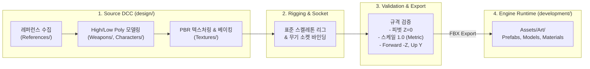
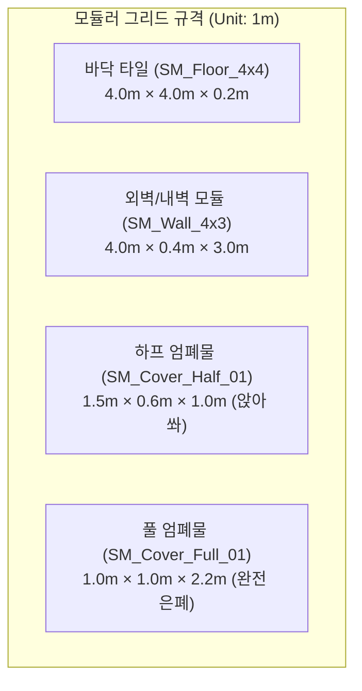

# 3D 게임 아트 파이프라인 아키텍처 (`design/ARCHITECTURE.md`)

본 문서는 Blender 3D DCC 도구와 Unity 게임 엔진 간의 **아트 에셋 파이프라인 아키텍처**, **모듈러 레벨 그리드 규격**, **캐릭터/무기 소켓 체계**를 정의합니다.

---

## 1. 아트 파이프라인 아키텍처 (단방향 흐름)

에셋의 품질 유지와 형상 관리(Version Control)를 위해 **Source(제작/가공)**와 **Runtime(엔진 실행)**을 엄격히 분리합니다.



---

## 2. 모듈러 레벨 그리드 아키텍처 (Modular Level Design)

1개 스테이지를 빠르고 견고하게 조립하기 위해 **미터(Metric) 단위 그리드 스냅 시스템**을 채택합니다.



### 피벗(Pivot) 및 스냅 원칙
- **모든 환경/엄폐물 에셋**: 지면과 맞닿는 하단 바닥면 중앙(`X=0, Y=0, Z=0`)에 피벗 고정.
- **모듈러 이음새**: 벽과 바닥의 맞닿는 면은 정확히 1m/4m 정수 단위로 스냅되도록 버텍스 정렬.

---

## 3. 캐릭터 & 무기 소켓 아키텍처 (Socket & Rig)

### 1) 공통 베이스 리그 (Humanoid Rig Standard)
5종의 적 캐릭터(`CH_Enemy_*`)와 플레이어 전신 모델(`SK_Player_FullBody`)은 동일한 뼈대 계층 구조를 공유합니다.

- **True First-Person Body Awareness**:
  - 플레이어가 아래를 내려다보았을 때 가슴, 다리, 발이 화면에 자연스럽게 노출되도록 설계.
  - 서기/앉기/포복(Prone) 시 하체 포복 애니메이션이 시야 하단에 직접 보임.
  - 1인칭 전용 카메라 위치: `Head` 본 위치에 스냅(단, 1인칭 시야 확보를 위해 머리 메시는 카메라 렌더링에서 마스킹/숨김 처리).

```text
Root
└── Pelvis (Hips)
    ├── Spine_01 -> Spine_02 -> Neck -> Head (Camera Snap / Head Hitbox)
    │   ├── Hitbox_Heart_Core <--- (흉부 정중앙 심장샷 히트박스: 2.0x 데미지)
    │   ├── Clavicle_L -> UpperArm_L -> LowerArm_L -> Hand_L
    │   └── Clavicle_R -> UpperArm_R -> LowerArm_R -> Hand_R
    │       └── Socket_Weapon_R  <--- (무기 장착 소켓: 손/무기 1인칭 가시화)
    ├── Thigh_L -> Calf_L -> Foot_L (아래 내려다볼 때 보이는 하체)
    └── Thigh_R -> Calf_R -> Foot_R
```

### 2) 무기 소켓 및 기믹 (Weapon Sockets)
무기 3D 모델에는 Unity 및 이펙트 연동을 위한 기준 빈 오브젝트(Empty)가 포함되어야 합니다.

- **`Socket_Grip`**: 캐릭터의 `Hand_R`에 달라붙는 파지 기준점.
- **`Socket_Muzzle`**: 총구 끝 (총구 화염/머즐 플래시, 레이저 빔 발사 시작 위치).
- **`Socket_Ejector`**: 탄피 배출구 위치 (기관총 연사 시 탄피 파티클 방출 지점).

### 3) 적 5종 모듈러 파츠 결합 방식
- 단일 베이스 메시(`CH_Enemy_Base`)에 부위별 파츠(`Headgear`, `Armor_Chest`, `Shoulder_Mount`, `Shield`)를 모듈러 소켓에 붙여 5가지 배리에이션을 완성합니다.

---

## 4. 사운드 에셋 파이프라인 아키텍처 (Audio Standards)

FPS의 타격감과 적 위치 식별(사운드 플레이)을 위해 오디오 규격을 표준화합니다.

- **포맷 및 샘플링 레이트**:
  - 원본/엔진 공통: **WAV (16-bit / 24-bit, 44.1kHz 또는 48kHz)**
- **채널 규격**:
  - **Mono (모노)**: 발소리, 총성, 피탄음, 적 대사 등 **3D 공간 음향(Spatial Audio 3D)**이 적용되어야 하는 모든 효과음 (Mono여야 Unity에서 방향과 거리 감쇠가 정확히 계산됨).
  - **Stereo (스테레오)**: BGM 및 앰비언스 룸톤 등 2D 전역 사운드.
- **사운드 네이밍 컨벤션**:
  - `SFX_Wep_<무기>_<동작>` (예: `SFX_Wep_MachineGun_Fire`)
  - `SFX_Move_<동작>_<자세>` (예: `SFX_Move_Crawl_Prone`, `SFX_Move_Step_Stand`)
  - `SFX_Impact_<재질>` (예: `SFX_Impact_Concrete`, `SFX_Impact_Metal`)

---

## 5. 에셋 생명주기 (Asset Lifecycle)

| 단계 | 상태 | 작업 내용 | 체크 기준 |
|:---:|:---|:---|:---|
| **Step 1** | **Blockout (그레이박스)** | 기본 도형으로 크기와 실루엣만 제작 | Unity 씬에서 스케일 및 조작감 검증 |
| **Step 2** | **High-to-Low Bake** | 디테일 스컬프팅 후 노멀 맵 베이킹 | 실시간 렌더링에 적합한 폴리곤 수 확보 |
| **Step 3** | **Texturing & PBR** | BaseColor, Metallic, Roughness, Normal 패킹 | 셰이더 매핑 및 라이팅 반응 확인 |
| **Step 4** | **Rig & Socket Bind** | 뼈대 스키닝 및 소켓 Transform 배치 | 애니메이션 시 메시 왜곡(Skinning) 없음 |
| **Step 5** | **Export & Verified** | Unity 임포트 및 Prefab 생성 완료 | 에러 및 스케일 불일치 0건 확인 |
