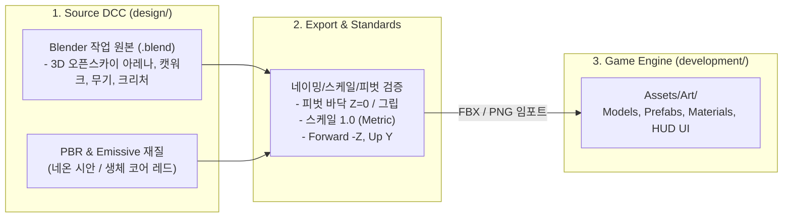

# 3D 에셋 및 디자인 파이프라인 가이드 (`design`)

본 문서는 **PROJECT: TARTARUS (OMEGA PROTOCOL)** 다크 SF 바이오 호러 전술 FPS 프로토타입(`sample.md` 컨셉 기반)에 필요한 3D 에셋, **3D 다층 수직 오픈스카이 아레나 환경**, 라이팅/포스트프로세싱, 사이버네틱 HUD 아트 규격 및 **Unity 6.3.8** 연동 파이프라인을 정의합니다.

---

## 1. 3D 게임 아트 & 비주얼 컨셉 아키텍처 (`sample.md` 기준)

프로그래밍에 Clean Architecture가 있듯, 게임 아트 분야에는 **"Source-to-Engine 단방향 분리"**와 **"표준 네이밍 컨벤션"** 원칙을 적용하며, `sample.md`의 **다크 SF 수직 발굴 분화구 아레나(`SEC-04 EXCAVATION CRATER` / `BIO-HAZARD L-4`)** 비주얼 무드를 충실히 구현합니다.



### 핵심 비주얼 & 공간 무드 원칙 (3D 입체·오픈스카이 아키텍처)
1. **3D 수직성(Verticality)과 오픈스카이(Open-Sky)**:
   - **폐쇄형 평면 복도 탈피**: 상공이 완전히 개방된 거대 발굴 분화구 및 다층 채굴 시설 구조를 채택.
   - **수직 사격각/전술 동선**: 지상 저지대(Ground Floor), 2~3층 공중 캣워크(Catwalk) 및 저격 타워, 경사로(Ramp), 산업용 계단(Stairs)을 유기적으로 연결하여 고지대 우위(High-Ground Advantage) 및 입체적 전투 공간을 제공합니다.
   - **공중 기동 공간**: 열린 천장을 통해 결전 드래곤 보스(`CH_Boss_ArchDreadRaze`) 및 비행체(`CH_Monster_SporeFlyer`)가 자유롭게 활공, 선회, 급강하 브레스 공격을 감행합니다.
2. **다크 SF 인더스트리얼 호러 무드**:
   - **외계 상공/안개**: 칠흑 같은 딥 네이비(`#020408`) 지수 안개(`FogExp2`)와 상공에서 쏟아지는 차가운 문라이트(Moonlight).
   - **대비 조명**: 캣워크와 지면 발판의 **시안 네온 가이드 스트립(`#06b6d4`)**과 괴수/보스 출현 시 깜빡이는 **적색 비상 경보등(`#ff1e1e`)**, 그리고 플레이어 총기 부착형 **고광량 택티컬 라이트(`#cffafe`)**의 강렬한 명암 대비.
3. **Source / Engine 분리**: Blender 작업 파일, 고해상도 베이크 맵, 레퍼런스는 `design/`에 보존하고, 엔진(`development/Assets/`)에는 최적화된 모델 및 텍스처만 내보냅니다.
4. **피벗(Pivot) 기준 준수**:
   - 지형/바닥/캣워크/엄폐물: 지면 바닥 접촉면 중앙 (`Z = 0`)
   - 무기: 1인칭 손 그립(Grip) 지점
   - 캐릭터/크리처: 양 발 사이 바닥 중앙

---

## 2. 디렉토리 구조 및 네이밍 규칙

### 디렉토리 구조 (에셋 1개 = `.blend` 파일 1개 분리 원칙)
```text
design/
├── References/              # 컨셉 아트 시트 및 Cropped/ (개별 크롭 PNG 31종)
├── prompt/                  # Nano Banana / Tripo 3D / Blender AI 프롬프트 가이드
├── Weapons/                 # 메인 무기 5종 (Wep_*.blend)
│   ├── Wep_ARC42_Valkyrie.blend
│   ├── Wep_Bergelmir09_Shotgun.blend
│   ├── Wep_KronosV_RailDMR.blend
│   ├── Wep_Aegis300_SmartSMG.blend
│   ├── Wep_HeliosX_BeamCannon.blend
│   ├── Secondary/           # 16종 부가 무기 및 런처 (Wep_Sec_01 ~ 16.blend)
│   └── Bullets/             # 9종 개별 탄환/발사체 (Wep_Bullet_01 ~ 09.blend)
├── Characters/              # 유저 캐릭터 및 몬스터/보스 분리 보관
│   ├── Players/             # 6종 유저 플레이어 캐릭터 (SK_Player_*, CH_Avatar_*.blend)
│   └── Monsters/            # 5종 일반 몬스터 및 1종 드래곤 메카 결전 보스 (CH_Boss_*, CH_Monster_*.blend)
├── Environment/             # 3D 수직 아레나 모듈 15종 (SM_*.blend, work1~3.blend 분할)
├── UI/                      # 사이버네틱 HUD 아이콘, 레이더 그리드
├── Textures/                # 원본 텍스처, 브러시, 베이크 맵
├── scripts/                 # 블렌더 자동 분할, 시트 크롭, 리깅, 정규화 파이썬 스크립트
├── work.blend               # 통합 씬 조립 및 보스/라이팅 작업 씬
├── work1.blend ~ work3.blend # 환경 시트 A/B/C Tripo 3D 원본 임포트 파일
└── README.md                # 본 문서
```

### 접두사 네이밍 컨벤션 (Industry Standard)
| 접두사 | 대상 | 예시 |
|:---|:---|:---|
| `SM_` | 정적 메시 (Static Mesh) | `SM_Corridor_ArchPillar`, `SM_Cover_Half_01` |
| `SK_` | 스켈레탈 메시 (리깅/스킨된 캐릭터, 관절 무기) | `SK_CH_Biotitan`, `SK_Player_FullBody` |
| `Wep_` | 무기 모델 | `Wep_PulseCarbine`, `Wep_SniperRifle` |
| `CH_` | 캐릭터/크리처 모델 | `CH_Biotitan_Specimen09`, `CH_Striker` |
| `M_` | 머티리얼 (Material) | `M_Corridor_MetalWall`, `M_BioCore_Emissive` |
| `T_` | 텍스처 (Texture) | `T_PulseCarbine_BaseColor`, `T_Corridor_Normal` |

---

## 3. 개발 대상 에셋 전체 목록 (Asset Checklist)

### A. 무기 에셋 5종 (`gun.png` 레퍼런스 기준)

| 에셋명 | 분류 | 특징 및 모델링 사양 |
|:---|:---|:---|
| **`Wep_ARC42_Valkyrie`** | **전자기 가속 돌격소총 (메인)** | 다크 티타늄 리시버, 핸드가드 6연장 블루 전자기 코어 코일, 상부 스마트 스코프 및 홀로그래픽 잔탄 디스플레이 |
| `Wep_Bergelmir09_Shotgun` | 중플라즈마 산탄총 | 화이트 불펍 바디, 전면 4연장 마그네틱 링 노즐, 후방 액체 헬륨 냉각 카트리지 |
| `Wep_KronosV_RailDMR` | 고주파 레일 DMR | 롱 실루엣 고배율 스마트 스코프, 듀얼 레일 배럴 사이 집속 코어, 은빛 커패시터 뱅크 |
| `Wep_Aegis300_SmartSMG` | 분산형 스마트 SMG | 컴팩트 바디, 원형 전범위 사격 센서, 상단 수평 원통 탄창 |
| `Wep_HeliosX_BeamCannon` | 극초단파 집속 빔 캐넌 | 인더스트리얼 옐로우 하우징, 3연장 회전식 빔 배럴 클러스터, 고압 절연 케이블 |

---

### B. 플레이어 및 적/보스 크리처 (`avartar.png`, `boss.png`, `monster.png` 기준)

| 분류 | 에셋명 | 외형 특징 및 전투 메커니즘 |
|:---|:---|:---|
| **플레이어 (나의 모습)** | **`SK_Player_AssaultOutrider`** | 화이트/오렌지 전술 슈트, 전술 스캔 바이저, 어깨 4연장 미사일 포드, 쉴드 발생기 |
| **플레이어 클래스 2** | `CH_Avatar_VanguardBreaker` | 네이비/옐로우 중장갑 아머, 동력 증폭 파워 외골격, 배면 과열 방열 벤트 |
| **플레이어 클래스 3** | `CH_Avatar_GhostRecon` | 스텔스 틸, 스펙트럼 센서 바이저, 홀로그래픽 광학 위장 망토 |
| **플레이어 클래스 4** | `CH_Avatar_StrikeGear` | 크림슨 레드 에어로 아머, 후면 고속 제트 추진기 및 에너지 플레임 |
| **플레이어 클래스 5** | `CH_Avatar_SentinelDefender` | 올리브 그린 중화기병, 흉부 아크 원자로 코어, 배면 핵융합 발전기 |
| **메인 결전 보스** | **`CH_Boss_ArchDreadRaze`** | 거대 사이버 드래곤 메카. 에너지 날개 추진기, 흉부 플라즈마 코어(약점), 어깨 중합 입자포, 꼬리 에너지 방출구 |
| **일반 몬스터 1** | `CH_Monster_Stalker` | 쿼드루페드(4족) 기계 표범 형태, 광학 센서 헤드, 등뒤 에너지 가시 |
| **일반 몬스터 2** | `CH_Monster_XenoTrooper` | 휴머노이드 외계 전사, 주황색 에너지 코어 및 전용 라이플 |
| **일반 몬스터 3** | `CH_Monster_GuardianBeast` | 갑각 공룡 형태의 중형 방어 괴수, 등뒤 청색 에너지 결정체 |
| **일반 몬스터 4** | `CH_Monster_SporeFlyer` | 비행 정찰형 개체, 에너지 추진 날개 및 하부 포자 발사 장치 |
| **일반 몬스터 5** | `CH_Monster_TitanBreaker` | 중장갑 타이탄 거인, 양 어깨 듀얼 대형 캐논, 흉부 코어 약점 |

---

### C. 3D 수직 오픈스카이 아레나 & 환경 모듈러 에셋 (`SEC-04 EXCAVATION CRATER`)

| 에셋명 | 규격 (가로×깊이×높이) | 3D 입체 전술 용도 및 사양 |
|:---|:---|:---|
| `SM_Catwalk_Straight_6m` | 1.34m × 6.0m × 0.94m | 공중 2층 철제 격자망 보행로, 양측 안전 난간 포함 (`work2.blend` 분할 완료) |
| `SM_Catwalk_Platform_4x4` | 3.95m × 4.0m × 2.12m | 다층 교차점 및 2층 저격/방어용 플랫폼 (`work2.blend` 분할 완료) |
| `SM_Stairs_Industrial_4m` | 4.20m × 5.32m × 4.0m | 지상과 2층(4m 높이)을 잇는 산업용 안전 계단 (`work2.blend` 분할 완료) |
| `SM_Ramp_Access_4m` | 6.0m × 3.37m × 2.49m | 화물 수송로 및 완만한 입체 우회로 (`work2.blend` 분할 완료) |
| `SM_Sniper_Tower_Octa` | 3.64m × 3.75m × 8.0m | 팔각형 다층 관측/저격 타워 + 사다리 통합 (`work2.blend` 분할 완료) |
| `SM_Truss_Arch_OpenSky` | 5.53m × 8.0m × 4.76m | 상공이 뚫려 하늘/보스 활공이 노출되는 오픈 트러스 골조 (`work1.blend` 분할 완료) |
| `SM_Crater_Floor_8x8` | 8.0m × 7.13m × 1.61m | 불규칙한 외계 암석 및 강화 금속 혼합 분화구 지면 (`work1.blend` 분할 완료) |
| `SM_Blast_Wall_4m` | 1.38m × 6.34m × 5.0m | 아레나 외곽 차폐용 중장갑 방폭벽 (`work1.blend` 분할 완료) |
| `SM_Blast_Wall_Doorway_4m` | 2.03m × 7.82m × 5.0m | 유압식 개구부가 포함된 방폭벽 게이트 (`work1.blend` 좌우 파트 통합) |
| `SM_Rock_Debris_Slope` | 5.01m × 4.45m × 4.0m | 고지대 우회가 가능한 자연 암석 슬로프 (`work1.blend` 분할 완료) |
| `SM_Cover_Low_Barricade` | 1.93m × 0.75m × **1.0m** | 하프 엄폐물: 전술 방호 바리케이드 (`work3.blend` 분할 완료) |
| `SM_Cover_High_HexPillar` | 1.24m × 1.22m × **2.4m** | 풀 엄폐물: 전신 은폐형 육각 서버 기둥 (`work3.blend` 분할 완료) |
| `SM_Crane_Suspended_Cargo`| 5.0m × 2.81m × 3.31m | 공중 컨테이너 프랍 (`work3.blend` 분할 완료) |
| `SM_Cryo_Containment_Tank`| 2.20m × 1.15m × 1.12m | 생체 발광 액체 함유 엄폐 탱크 (`work3.blend` 분할 완료) |
| `SM_Debris_Rock_Mound` | 2.11m × 2.40m × 1.24m | 암석/폐기물 엄폐 더미 (`work3.blend` 분할 완료) |

---

### D. 사이버네틱 HUD & 포스트프로세싱 디자인 규격 (글자 잘림/세로 줄바꿈 방지 포함)

`sample.md`의 전술 인터페이스 구성 요소를 Unity Canvas(`1920×1080` 기준)에 이식하되, **샘플 웹 화면에서 버튼이나 패널 폭이 좁아 한글/영문이 세로로 쪼개지거나 잘리던 현상을 원천 방지**합니다.

1. **상단 HUD (Top Telemetry & Threat Header)**:
   - **좌측 (작전 환경 텔레메트리)**: `SEC-04 EXCAVATION` (시안 핑 도트), `REC [00:41:19]`, `O2: 97.4% | TEMP: -4.2°C | RAD: 14 mSv/h`, `ATMOSPHERE: CONTAMINATED / BIO-HAZARD L-4`.
   - **중앙 (디지털 나침반)**: `NW 315 | N 004° | 045 NE` 실시간 조준 방위각 및 `TARGET: SPECIMEN-09 EXTERMINATION`.
   - **우측 (근접 위협 경보)**: `PROXIMITY ALERT : CRITICAL`, 5칸 분할 적색 위협 게이지 바, 실시간 괴수 거리(`HOSTILE TARGET / DIST: 14.2 M`).
2. **중앙 조준기 (Center Reticle & Target Lock)**:
   - 이중 시안 서클(외곽 링 + 회전 점선 링), 4방향 시안 발광 브래킷, 중앙 도트, 사격 시 확장 펄스.
   - 적 포착 시 4모서리 적색 타깃 락 브래킷 + 하단 단일 행 태그(`LOCKED: BIOTITAN // HOSTILE`).
3. **하단 HUD (Bottom Vitals, Tactical Controls & Radar/Ammo)**:
   - **하단 좌측 (생존/슈트 게이지)**: `SHIELD MATRIX (85%)` 시안 그라데이션 바, `VITALITY (100%)` 에메랄드 그라데이션 바, `BATTERY: 98% | STAMINA: OPTIMAL`.
   - **하단 중앙 (전술 액션 컨트롤 바 & 단축키 가이드)**:
     - 5종 전술 버튼: `[사격 FIRE]`, `[재장전]`, `[야간투시]`, `[열화상]`, `[택티컬 라이트]`
     - 하단 조작 레전드: `L-CLICK 무기 격발 | R 재장전 | N / T 투시 모드 변경 | F 라이트 | DRAG 시점 탐색`
   - **하단 우측 (30M 회전 레이더 & 탄약 매트릭스)**:
     - **30M 전술 레이더**: 동심원 그리드, 360도 회전 스윕 팬, 중앙 플레이어 도트, 적색 몬스터 핑 블립.
     - **탄약 매트릭스**: `PULSE CARBINE / FULL-AUTO`, 대형 네온 잔탄 숫자(`36 / 45`), 잔탄 게이지 바(25% 미만 시 적색 경고), `MAG: 4/4 | TYPE: KINETIC-PL`.
4. **텍스트 세로 꺾임 및 잘림 방지 필수 규칙 (UI Layout Rule)**:
   - 모든 버튼과 라벨은 **단일 행 가로 배치(`No Wrap` / `white-space: nowrap`)**를 강제 적용합니다.
   - 하단 중앙 컨트롤 바의 각 버튼은 텍스트 길이에 맞춰 가로 폭이 자동 확장(`HorizontalLayoutGroup` + `ContentSizeFitter Preferred Size` + 충분한 좌우 패딩 `Padding Left/Right ≥ 16px`)되도록 설계하여, 어떤 해상도에서도 글자가 세로로 줄바꿈되거나 잘리지 않게 합니다.

---

## 4. 제작 파이프라인 (추천 작업 흐름)

```text
[Step 1] Unity 씬에 3D 오픈스카이 스카이박스, 지수 안개(Fog), 캣워크 시안 LED 가이드, 메인 문라이트 세팅
   ↓
[Step 2] design/Environment/ 에서 3D 수직 아레나 모듈(분화구 바닥, 캣워크, 계단, 경사로, 오픈 트러스 아치, 엄폐물) 배치
   ↓
[Step 3] design/Weapons/ 에서 1인칭 펄스 카빈/메인 무기 5종 및 부가 무기 16종, 탄환 9종 연동
   ↓
[Step 4] design/Characters/ 에서 6종 플레이어 및 5종 몬스터 배치, 상공에 드래곤 메카 결전 보스(비행/강하 브레스) 세팅
   ↓
[Step 5] 사이버네틱 HUD(고저차 거리 표시 나침반/레이더, 상단 텔레메트리, 중앙 타깃 락, 하단 바이탈/전술 버튼 바) 및 NVG·열화상 연동
```

---

## 5. AI 에셋 생성 및 `.blend` 자동 분할·정규화 워크플로우

본 프로젝트의 3D 에셋은 **Nano Banana(2D 컨셉 시트) → Tripo 3D(메쉬 생성) → Blender MCP/Python(분할·정규화)** 파이프라인으로 제작되었습니다.

### 5-1. 프롬프트 설계 방식 (`design/prompt/`)
- **톤앤매너 고정**: 모든 프롬프트에 다크 SF 인더스트리얼 호러 무드(다크 건메탈 `#1e293b`, 시안 네온 `#06b6d4`, 경고 옐로우/레드)를 공통 키워드로 부여해 에셋 간 이질감을 제거했습니다.
- **Nano Banana → Tripo 분리 설계** ([`design/prompt/README.md`](file:///home/yang/work/ai-sample/design/prompt/README.md)):
  - **Nano Banana용**: Tripo 3D가 파츠를 깔끔하게 인식하도록 **단색 회색(`#808080`) 무그림자 배경**, **에셋 간 충분한 여백**, **정투영/3/4 뷰**를 강제하는 시트 프롬프트를 구성했습니다([`01_environment_3d_arena.md`](file:///home/yang/work/ai-sample/design/prompt/01_environment_3d_arena.md), [`02_weapons_characters_monsters.md`](file:///home/yang/work/ai-sample/design/prompt/02_weapons_characters_monsters.md)).
  - **시트 크롭(Crop)**: 생성된 컨셉 시트는 [`crop_concept_sheets.py`](file:///home/yang/work/ai-sample/design/scripts/crop_concept_sheets.py) 및 [`crop_env_sheets.py`](file:///home/yang/work/ai-sample/design/scripts/crop_env_sheets.py)로 개별 PNG 31종([`design/References/Cropped/`](file:///home/yang/work/ai-sample/design/References/Cropped))으로 분할해 단품 재생성 및 레퍼런스로 재사용할 수 있게 했습니다.
  - **Tripo 3D용**: 환경 에셋은 리깅이 불필요하므로 `Auto-Rig OFF` + `Image-to-3D`(또는 단품 `Text-to-3D`) 규칙을 명시했습니다.

### 5-2. `.blend` 자동 분할 및 정규화 방식 (`design/scripts/`)
Tripo Bridge로 임포트한 원본 `.blend`에는 여러 오브젝트가 한 씬에 묶여 있거나 스케일·피벗이 제각각이므로, **1 에셋 = 1 `.blend`** 원칙에 따라 Blender Python 스크립트로 일괄 정규화했습니다.

1. **오브젝트 분리 및 다중 파트 병합**: 공간 좌표 또는 파트명(`tripo_part_*`) 기준으로 동일 에셋 파트를 묶고 `bpy.ops.object.join()`으로 단일 메쉬화.
2. **트랜스폼 베이크 & 실측 스케일링**: 부모 Empty 해제 후 월드 변환 행렬을 메쉬 정점에 베이크(`Matrix.Identity(4)`)하고 `plan.md` 규격(미터 단위)에 맞춰 균일 스케일 적용.
3. **피벗(Origin) 정렬**: 환경 모듈은 바닥 접촉면(`Z_min = 0`) 및 `X=0, Y=0` 중심 정렬, 무기/탄환/캐릭터는 원점 `(0, 0, 0)` 및 소켓 부착.
4. **고아 데이터블록 정리 & 저장**: `orphans_purge(do_recursive=True)` 후 개별 `.blend` 파일로 저장.

| 대상 | 원본 파일 | 실행 스크립트 | 산출물 |
|---|---|---|---|
| **환경 모듈 15종** | `work1.blend`~`work3.blend` | [`process_environment_blends.py`](file:///home/yang/work/ai-sample/design/scripts/process_environment_blends.py) | `design/Environment/SM_*.blend` (15개) |
| **메인 무기 5종** | `work.blend` (시트 임포트) | [`process_five_weapons.py`](file:///home/yang/work/ai-sample/design/scripts/process_five_weapons.py) | `design/Weapons/Wep_*.blend` (5개) |
| **부가 무기 16종** | Tripo 25파트 시트 | [`process_secondary_weapons_v2.py`](file:///home/yang/work/ai-sample/design/scripts/process_secondary_weapons_v2.py) | `design/Weapons/Secondary/Wep_Sec_*.blend` (16개) |
| **탄환/발사체 9종** | Tripo 159파트 시트 | [`process_nine_bullets.py`](file:///home/yang/work/ai-sample/design/scripts/process_nine_bullets.py) | `design/Weapons/Bullets/Wep_Bullet_*.blend` (9개) |
| **플레이어 6종** | Tripo 57파트 시트 | [`process_six_characters.py`](file:///home/yang/work/ai-sample/design/scripts/process_six_characters.py), [`rig_all_characters_and_monsters.py`](file:///home/yang/work/ai-sample/design/scripts/rig_all_characters_and_monsters.py) | `design/Characters/Players/*.blend` (6개, Armature+120f 애니메이션) |
| **일반 몬스터 5종** | Tripo 163파트 시트 | [`process_five_monsters.py`](file:///home/yang/work/ai-sample/design/scripts/process_five_monsters.py), [`rig_all_characters_and_monsters.py`](file:///home/yang/work/ai-sample/design/scripts/rig_all_characters_and_monsters.py) | `design/Characters/Monsters/CH_Monster_*.blend` (5개, Armature+120f 애니메이션) |
| **결전 보스 1종** | `work.blend` (`boss.png`) | [`rig_tripo_mesh.py`](file:///home/yang/work/ai-sample/design/scripts/rig_tripo_mesh.py), [`export_dragon_to_unity.py`](file:///home/yang/work/ai-sample/design/scripts/export_dragon_to_unity.py) | `CH_Boss_ArchDreadRaze.blend` + Unity FBX/4K PBR |

### 5-3. 리깅 · 오디오 · VFX 방향 (새 세션 참고)
- **리깅 상태**: 플레이어 6종 + 일반 몬스터 5종 + 보스 1종 **총 12종 모두 Armature + 스키닝 + `*_Combat_Idle` 120f 루프** 보유. *(다음 Tripo 생성 시에는 정면 A-Pose 단품으로 생성해 후처리 최소화)*
- **오디오/VFX**: `.blend`와 무관하게 **Unity에 직접 임포트**하며, Python `.wav` 합성은 사용하지 않고 구매 에셋(`Weapon Soldier Sounds Pack Fps`, `100 베스트 이펙트` 등) + 외부 오디오 AI(ElevenLabs 등)를 사용합니다.
