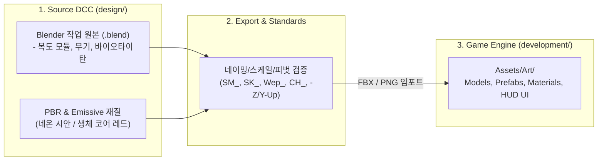

# 3D 에셋 및 디자인 파이프라인 가이드 (`design`)

본 문서는 **PROJECT: TARTARUS (OMEGA PROTOCOL)** 다크 SF 바이오 호러 전술 FPS 프로토타입(`sample.md` 컨셉 기반)에 필요한 3D 에셋, 폐쇄형 발굴 기지 복도 환경, 라이팅/포스트프로세싱, 사이버네틱 HUD 아트 규격 및 **Unity 6.3.8** 연동 파이프라인을 정의합니다.

---

## 1. 3D 게임 아트 & 비주얼 컨셉 아키텍처 (`sample.md` 기준)

프로그래밍에 Clean Architecture가 있듯, 게임 아트 분야에는 **"Source-to-Engine 단방향 분리"**와 **"표준 네이밍 컨벤션"** 원칙을 적용하며, `sample.md`의 **다크 SF 지하 발굴 기지(`SEC-04 EXCAVATION` / `BIO-HAZARD L-4`)** 비주얼 무드를 충실히 구현합니다.



### 핵심 비주얼 & 공간 무드 원칙
1. **다크 SF 인더스트리얼 호러 무드**:
   - **배경/안개**: 칠흑 같은 딥 네이비(`#020408`) 지수 안개(`FogExp2`)와 저조도 앰비언트(`#0a1120`).
   - **대비 조명**: 천장/벽면의 차가운 **시안 네온 스트립(`#06b6d4`)**과 괴수 근처에서 불규칙하게 깜빡이는 **적색 비상 경보등(`#ff1e1e`)**, 그리고 플레이어 총기에 부착된 **고광량 택티컬 라이트(`#cffafe`)**의 강렬한 명암 대비.
2. **Source / Engine 분리**: Blender 작업 파일, 고해상도 베이크 맵, 레퍼런스는 `design/`에 보존하고, 엔진(`development/Assets/`)에는 최적화된 모델 및 텍스처만 내보냅니다.
3. **모듈러(Modular) 복도 설계**: 폭 12m × 높이 4.2m × 깊이 5m 단위의 아치형 기둥·배관·바닥 그리드 모듈을 조립하여 60m급 지하 발굴 복도를 구성합니다.
4. **피벗(Pivot) 기준 준수**:
   - 정적 프랍/복도 모듈/엄폐물: 지면 바닥 접촉면 중앙 (`Z = 0`)
   - 무기: 1인칭 손 그립(Grip) 지점
   - 캐릭터/크리처: 양 발 사이 바닥 중앙

---

## 2. 디렉토리 구조 및 네이밍 규칙

### 디렉토리 구조
```text
design/
├── References/              # 컨셉 아트, sample.md 목업, 무드보드
├── Weapons/                 # 펄스 카빈 등 무기 3D 소스 파일 (.blend, 파츠)
├── Characters/              # 바이오타이탄(Specimen-09) 및 적 캐릭터 소스 파일
├── Environment/             # 지하 연구소 복도 모듈, 아치 기둥, 배관, 엄폐물
├── UI/                      # 사이버네틱 HUD 아이콘, 레이더 그리드, 크로스헤어 아트워크
├── Textures/                # 원본 텍스처, 브러시, 베이크 맵
├── work.blend               # 메인 통합 작업 원본
└── README.md                # 본 문서
```

### 접두사 네이밍 컨벤션 (Industry Standard)
| 접두사 | 대상 | 예시 |
|:---|:---|:---|
| `SM_` | 정적 메시 (Static Mesh) | `SM_Corridor_ArchPillar`, `SM_Cover_Half_01` |
| `SK_` | 스켈레탈 메시 (리깅/스킨된 캐릭터, 관절 무기) | `SK_CH_Biotitan`, `SK_Player_FullBody` |
| `Wep_` | 무기 모델 | `Wep_PulseCarbine`, `Wep_SniperRifle` |
| `CH_` | 캐릭터/크리처 모델 | `CH_Biotitan_Specimen09`, `CH_Striker` |
| `M_` | 머티리얼 (Material) | `M_Corridor_MetalWall`, `M_BioCore_Emissive` |
| `T_` | 텍스처 (Texture) | `T_PulseCarbine_BaseColor`, `T_Corridor_Normal` |

---

## 3. 개발 대상 에셋 전체 목록 (Asset Checklist)

### A. 무기 에셋 5종 (`gun.png` 레퍼런스 기준)

| 에셋명 | 분류 | 특징 및 모델링 사양 |
|:---|:---|:---|
| **`Wep_ARC42_Valkyrie`** | **전자기 가속 돌격소총 (메인)** | 다크 티타늄 리시버, 핸드가드 6연장 블루 전자기 코어 코일, 상부 스마트 스코프 및 홀로그래픽 잔탄 디스플레이 |
| `Wep_Bergelmir09_Shotgun` | 중플라즈마 산탄총 | 화이트 불펍 바디, 전면 4연장 마그네틱 링 노즐, 후방 액체 헬륨 냉각 카트리지 |
| `Wep_KronosV_RailDMR` | 고주파 레일 DMR | 롱 실루엣 고배율 스마트 스코프, 듀얼 레일 배럴 사이 집속 코어, 은빛 커패시터 뱅크 |
| `Wep_Aegis300_SmartSMG` | 분산형 스마트 SMG | 컴팩트 바디, 원형 전범위 사격 센서, 상단 수평 원통 탄창 |
| `Wep_HeliosX_BeamCannon` | 극초단파 집속 빔 캐넌 | 인더스트리얼 옐로우 하우징, 3연장 회전식 빔 배럴 클러스터, 고압 절연 케이블 |

---

### B. 플레이어 및 적/보스 크리처 (`avartar.png`, `boss.png`, `monster.png` 기준)

| 분류 | 에셋명 | 외형 특징 및 전투 메커니즘 |
|:---|:---|:---|
| **플레이어 (나의 모습)** | **`SK_Player_AssaultOutrider`** | 화이트/오렌지 전술 슈트, 전술 스캔 바이저, 어깨 4연장 미사일 포드, 쉴드 발생기 |
| **플레이어 클래스 2** | `CH_Avatar_VanguardBreaker` | 네이비/옐로우 중장갑 아머, 동력 증폭 파워 외골격, 배면 과열 방열 벤트 |
| **플레이어 클래스 3** | `CH_Avatar_GhostRecon` | 스텔스 틸, 스펙트럼 센서 바이저, 홀로그래픽 광학 위장 망토 |
| **플레이어 클래스 4** | `CH_Avatar_StrikeGear` | 크림슨 레드 에어로 아머, 후면 고속 제트 추진기 및 에너지 플레임 |
| **플레이어 클래스 5** | `CH_Avatar_SentinelDefender` | 올리브 그린 중화기병, 흉부 아크 원자로 코어, 배면 핵융합 발전기 |
| **메인 결전 보스** | **`CH_Boss_ArchDreadRaze`** | 거대 사이버 드래곤 메카. 에너지 날개 추진기, 흉부 플라즈마 코어(약점), 어깨 중합 입자포, 꼬리 에너지 방출구 |
| **일반 몬스터 1** | `CH_Monster_Stalker` | 쿼드루페드(4족) 기계 표범 형태, 광학 센서 헤드, 등뒤 에너지 가시 |
| **일반 몬스터 2** | `CH_Monster_XenoTrooper` | 휴머노이드 외계 전사, 주황색 에너지 코어 및 전용 라이플 |
| **일반 몬스터 3** | `CH_Monster_GuardianBeast` | 갑각 공룡 형태의 중형 방어 괴수, 등뒤 청색 에너지 결정체 |
| **일반 몬스터 4** | `CH_Monster_SporeFlyer` | 비행 정찰형 개체, 에너지 추진 날개 및 하부 포자 발사 장치 |
| **일반 몬스터 5** | `CH_Monster_TitanBreaker` | 중장갑 타이탄 거인, 양 어깨 듀얼 대형 캐논, 흉부 코어 약점 |

---

### C. 지하 발굴 기지 복도 환경 & 모듈러 엄폐물 에셋 (`SEC-04 EXCAVATION`)

| 에셋명 | 규격 (가로×깊이×높이) | 용도 및 설명 (`sample.md` 복도 규격) |
|:---|:---|:---|
| `SM_Corridor_Floor` | 12.0m × 5.0m × 0.2m | 인더스트리얼 메탈 그리드 바닥 타일 (`#0f131a`, 고금속성 반사) |
| `SM_Corridor_Wall` | 0.3m × 5.0m × 4.2m | 좌/우측 중장갑 금속 복도 벽체 및 천장 마감 패널 (`#181c24`) |
| `SM_Corridor_ArchPillar` | 12.0m × 0.4m × 4.2m | 5m 간격으로 배치되는 복도 보강용 좌/우 기둥(`0.5×4.2×0.4m`) 및 상단 가로보(`11.8×0.4×0.4m`) |
| `SM_Corridor_NeonStrip` | 0.08m × 4.8m × 0.05m | 천장 좌/우(`X = ±2.5m`)에 부착되는 시안색(`#06b6d4`) 네온 컨듀잇 발광 라인 |
| `SM_Corridor_WallPipe` | Ø0.24m × 5.0m | 복도 우측/좌측 벽면을 따라 이어지는 산업용 금속 배관 파이프 (`#334155`) |
| `SM_Cover_Half_01` | 1.5m × 0.6m × **1.0m** | 하프 엄폐물: 전술 방호 바리케이드 (앉아서 사격 및 시야 확보) |
| `SM_Cover_Full_01` | 1.0m × 1.0m × **2.2m** | 풀 엄폐물: 육각 방탄 기둥 (완전 은폐 가능) |

---

### D. 사이버네틱 HUD & 포스트프로세싱 디자인 규격 (글자 잘림/세로 줄바꿈 방지 포함)

`sample.md`의 전술 인터페이스 구성 요소를 Unity Canvas(`1920×1080` 기준)에 이식하되, **샘플 웹 화면에서 버튼이나 패널 폭이 좁아 한글/영문이 세로로 쪼개지거나 잘리던 현상을 원천 방지**합니다.

1. **상단 HUD (Top Telemetry & Threat Header)**:
   - **좌측 (작전 환경 텔레메트리)**: `SEC-04 EXCAVATION` (시안 핑 도트), `REC [00:41:19]`, `O2: 97.4% | TEMP: -4.2°C | RAD: 14 mSv/h`, `ATMOSPHERE: CONTAMINATED / BIO-HAZARD L-4`.
   - **중앙 (디지털 나침반)**: `NW 315 | N 004° | 045 NE` 실시간 조준 방위각 및 `TARGET: SPECIMEN-09 EXTERMINATION`.
   - **우측 (근접 위협 경보)**: `PROXIMITY ALERT : CRITICAL`, 5칸 분할 적색 위협 게이지 바, 실시간 괴수 거리(`HOSTILE TARGET / DIST: 14.2 M`).
2. **중앙 조준기 (Center Reticle & Target Lock)**:
   - 이중 시안 서클(외곽 링 + 회전 점선 링), 4방향 시안 발광 브래킷, 중앙 도트, 사격 시 확장 펄스.
   - 적 포착 시 4모서리 적색 타깃 락 브래킷 + 하단 단일 행 태그(`LOCKED: BIOTITAN // HOSTILE`).
3. **하단 HUD (Bottom Vitals, Tactical Controls & Radar/Ammo)**:
   - **하단 좌측 (생존/슈트 게이지)**: `SHIELD MATRIX (85%)` 시안 그라데이션 바, `VITALITY (100%)` 에메랄드 그라데이션 바, `BATTERY: 98% | STAMINA: OPTIMAL`.
   - **하단 중앙 (전술 액션 컨트롤 바 & 단축키 가이드)**:
     - 5종 전술 버튼: `[사격 FIRE]`, `[재장전]`, `[야간투시]`, `[열화상]`, `[택티컬 라이트]`
     - 하단 조작 레전드: `L-CLICK 무기 격발 | R 재장전 | N / T 투시 모드 변경 | F 라이트 | DRAG 시점 탐색`
   - **하단 우측 (30M 회전 레이더 & 탄약 매트릭스)**:
     - **30M 전술 레이더**: 동심원 그리드, 360도 회전 스윕 팬, 중앙 플레이어 도트, 적색 몬스터 핑 블립.
     - **탄약 매트릭스**: `PULSE CARBINE / FULL-AUTO`, 대형 네온 잔탄 숫자(`36 / 45`), 잔탄 게이지 바(25% 미만 시 적색 경고), `MAG: 4/4 | TYPE: KINETIC-PL`.
4. **텍스트 세로 꺾임 및 잘림 방지 필수 규칙 (UI Layout Rule)**:
   - 모든 버튼과 라벨은 **단일 행 가로 배치(`No Wrap` / `white-space: nowrap`)**를 강제 적용합니다.
   - 하단 중앙 컨트롤 바의 각 버튼은 텍스트 길이에 맞춰 가로 폭이 자동 확장(`HorizontalLayoutGroup` + `ContentSizeFitter Preferred Size` + 충분한 좌우 패딩 `Padding Left/Right ≥ 16px`)되도록 설계하여, 어떤 해상도에서도 글자가 세로로 줄바꿈되거나 잘리지 않게 합니다.

---

## 4. 제작 파이프라인 (추천 작업 흐름)

```text
[Step 1] Unity 씬에 다크 네이비 안개(Fog), 비상 적색 점멸등, 시안 네온 조명 및 URP Volume 세팅
   ↓
[Step 2] design/Environment/ 에서 지하 발굴 기지 복도 모듈(바닥/벽/아치 기둥/배관/네온) 모델링 및 배치
   ↓
[Step 3] design/Weapons/ 에서 펄스 카빈(홀로그램 스크린 & 택티컬 라이트 포함) 및 무기 모델링 후 1인칭 카메라 장착
   ↓
[Step 4] design/Characters/ 에서 바이오타이탄(Specimen-09, 발광 생체 코어 & 낫 블레이드 & 포자 파티클) 제작 및 배치
   ↓
[Step 5] 사이버네틱 HUD(상단 텔레메트리, 중앙 타깃 락, 하단 바이탈/전술 버튼 바/레이더/탄약) 및 NVG·열화상 투시 연동
```
