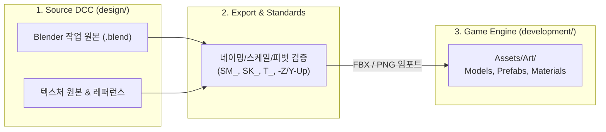

# 3D 에셋 및 디자인 파이프라인 가이드 (`design`)

본 문서는 FPS 단일 스테이지 프로토타입에 필요한 3D 에셋의 기획 목록, 업계 표준 디렉토리 관리 규칙, 그리고 Unity 연동 파이프라인을 정의합니다.

---

## 1. 3D 게임 아트 아키텍처 원칙 (Game Asset Pipeline)

프로그래밍에 Clean Architecture가 있듯, 게임 아트 분야에는 **"Source-to-Engine 단방향 분리"**와 **"표준 네이밍 컨벤션"**이라는 확립된 산업 표준 규칙이 있습니다.



### 핵심 원칙
1. **Source / Engine 분리**: Blender 작업 파일, 고해상도 베이크 맵, 무드보드/레퍼런스는 `design/`에 보존하고, 엔진(`development/Assets/`)에는 최적화된 `.fbx` 및 텍스처만 내보냅니다.
2. **모듈러(Modular) 설계**: 벽과 엄폐물은 1m, 2m, 4m 단위 그리드에 딱 맞게 제작하여 조립식으로 맵을 구성합니다.
3. **피벗(Pivot) 기준 준수**:
   - 정적 프랍/벽/엄폐물: 지면 바닥 접촉면 중앙 (`Z = 0`)
   - 무기: 1인칭 손 그립(Grip) 지점
   - 캐릭터: 양 발 사이 바닥 중앙

---

## 2. 디렉토리 구조 및 네이밍 규칙

### 디렉토리 구조
```text
design/
├── References/              # 컨셉 아트, 무드보드, 사진 자료
├── Weapons/                 # 무기 3D 소스 파일 (.blend, 파츠)
├── Characters/              # 캐릭터 베이스 및 파츠 소스 파일
├── Environment/             # 모듈러 벽, 엄폐물, 바닥 소스 파일
├── Textures/                # 원본 텍스처, 브러시, 베이크 맵
├── work.blend               # 메인 통합 작업 원본
└── README.md                # 본 문서
```

### 접두사 네이밍 컨벤션 (Industry Standard)
| 접두사 | 대상 | 예시 |
|:---|:---|:---|
| `SM_` | 정적 메시 (Static Mesh) | `SM_Cover_Half_01`, `SM_Wall_4x3` |
| `SK_` | 스켈레탈 메시 (리깅/스킨된 캐릭터, 관절 무기) | `SK_Enemy_Striker`, `SK_Weapon_Plasma` |
| `Wep_` | 무기 모델 | `Wep_MachineGun`, `Wep_CombatKnife` |
| `CH_` | 캐릭터 모델 | `CH_Enemy_Scout`, `CH_Enemy_Heavy` |
| `M_` | 머티리얼 (Material) | `M_Gun_Metal`, `M_Concrete_Wall` |
| `T_` | 텍스처 (Texture) | `T_MachineGun_BaseColor`, `T_MachineGun_Normal` |

---

## 3. 개발 대상 에셋 전체 목록 (Asset Checklist)

### A. 무기 에셋 (3종)

| 에셋명 | 분류 | 특징 및 모델링 가이드 |
|:---|:---|:---|
| `Wep_MachineGun` | 실탄 연사 | 현대/근미래 돌격소총. 본체와 탄창(Magazine) 분리형 제작 (재장전 애니메이션용). |
| `Wep_PlasmaCaster` | 에너지/레이저 | *에일리언 vs 프레데터* 프레데터 숄더 캐논 모티브. 각진 에너지 코어, 총열 개폐 기믹. |
| `Wep_CombatKnife` | 근접 무기 | 전술 컴뱃 나이프 (또는 에너지 엣지 단검). 날렵하고 절제된 밀리터리 SF 디자인. |

---

### B. 적(Enemy) 캐릭터 에셋 (일반 5종 + 대형 보스 1종)

공통 베이스 바디(`CH_Enemy_Base`) 1종을 기반으로 외형 아머, 무기 장착부, 색상/실루엣을 변경하여 5종을 효율적으로 구성하며, 스테이지 최종 관문으로 **대형 보스 1종**을 추가 제작합니다.

| 분류 | 에셋명 | 외형 특징 | 전술 성향 및 피격 규칙 |
|:---|:---|:---|:---|
| **원거리 1** | `CH_Striker` (돌격 소총병) | 표준 전술 방탄 아머, 바이저 헬멧, 소총 파지 | 엄폐 위주 사격 (**헤드/심장 피격 시 원킬 즉사**) |
| **원거리 2** | `CH_PlasmaHeavy` (중화기병) | 육중한 어깨 견착 캐논, 중장갑 배틀수트 | 고위력 단발 저격 (**헤드/심장 피격 시 원킬 즉사**) |
| **근거리 1** | `CH_ScoutRunner` (돌격병) | 슬림하고 경량화된 다리 파츠, 가벼운 단검 | 빠른 지그재그 돌진 (**헤드/심장 피격 시 원킬 즉사**) |
| **근거리 2** | `CH_Bruiser` (중장갑 뱅가드) | 대형 전술 쉴드(방패)와 충격 곤봉 장착 | 정면 방어 전진 (**헤드/심장 피격 시 원킬 즉사**) |
| **근거리 3** | `CH_Stalker` (암살/우회병) | 날렵한 유선형 바디, 양손 듀얼 블레이드 | 사각지대 기습 우회 (**헤드/심장 피격 시 원킬 즉사**) |
| **최종 보스** | **`CH_Boss_Goliath` (거대 결전 메카 골리앗)** | **신장 3.5m ~ 4.0m의 초대형 체구**, 어깨 개폐식 미사일 포드, 흉부 대형 빔 렌즈 코어, 듀얼 개틀링 암 | **원킬 면제**, 미사일 융단폭격/플라즈마 빔/지면 강타 등 요란한 파괴 패턴, 2페이즈 오버히트 광폭화 |

---

### C. 스테이지 환경 & 모듈러 엄폐물 에셋

| 에셋명 | 규격 (가로×깊이×높이) | 용도 및 설명 |
|:---|:---|:---|
| `SM_Cover_Half_01` | 1.5m × 0.6m × **1.0m** | 하프 엄폐물: 바리케이드/배럴 묶음 (앉아서 사격 및 시야 확보) |
| `SM_Cover_Full_01` | 1.0m × 1.0m × **2.2m** | 풀 엄폐물: 육각 콘크리트 기둥 (완전 은폐 가능) |
| `SM_Wall_4x3` | 4.0m × 0.4m × 3.0m | 스테이지 외벽/실내 벽체 모듈 |
| `SM_Wall_Corner` | 1.0m × 1.0m × 3.0m | 벽체 코너 연결 모듈 |
| `SM_Floor_4x4` | 4.0m × 4.0m × 0.2m | 타일식 바닥 베이스 모듈 |

---

## 4. 제작 파이프라인 (추천 작업 흐름)

```text
[Step 1] Unity 씬에서 기본 큐브로 레벨 동선 및 엄폐 높이 검증 (그레이박싱)
   ↓
[Step 2] design/Environment/ 에서 규격에 맞춰 모듈러 벽/엄폐물 모델링 및 교체
   ↓
[Step 3] design/Weapons/ 에서 무기 3종 모델링 및 Unity 1인칭 카메라 리그에 장착
   ↓
[Step 4] design/Characters/ 에서 베이스 프레임 제작 및 파츠별 5종 변형 완성
```
