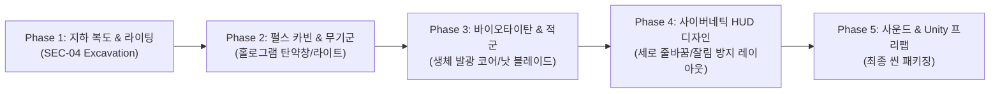

# 3D 디자인 및 에셋 제작 계획서 (`design/plan.md`)

본 문서는 **PROJECT: TARTARUS (`sample.md` 다크 SF 바이오 호러 전술 FPS)** 구현을 위한 Blender 3D 모델링, 지하 발굴 복도 환경, 라이팅/비전 효과, 사이버네틱 HUD 디자인 및 Unity 연동 **상세 작업 목록(WBS)**을 정의합니다.

---

## 작업 진행 현황 요약

---

## 세부 제작 목록 (Checklist)

### Phase 1: 지하 발굴 기지 복도 환경 & 다크 호러 조명 (`design/Environment/`)
> `sample.md`의 `SEC-04 EXCAVATION` 폐쇄형 금속 복도 및 안개·조명·엄폐물 세팅

- [ ] **지하 복도 모듈러 구조물 (폭 12m × 높이 4.2m × 길이 60m 구성)**
  - [ ] `SM_Corridor_Floor.blend` (12.0m × 5.0m × 0.2m 인더스트리얼 금속 그리드 바닥, `#0f131a`, Metalness 0.9, Roughness 0.35)
  - [ ] `SM_Corridor_Wall.blend` (0.3m × 5.0m × 4.2m 좌/우 중장갑 금속 벽체 및 천장 패널, `#181c24`, Metalness 0.85, Roughness 0.65)
  - [ ] `SM_Corridor_ArchPillar.blend` (5m 간격 아치형 지지 기둥 `0.5×4.2×0.4m` 좌/우 한 쌍 + 상단 가로보 `11.8×0.4×0.4m`)
  - [ ] `SM_Corridor_NeonStrip.blend` (천장 `X = ±2.5m, Y = 4.15m` 시안 네온 발광 스트립 `0.08×4.8×0.05m`, `#06b6d4` Emissive)
  - [ ] `SM_Corridor_WallPipe.blend` (벽면 `X = 5.85m, Y = 1.2m` 고압 산업 배관 파이프 `Ø0.24m × 5.0m`, `#334155`)
- [ ] **전술 엄폐물 프랍 (바닥면 피벗 Z=0)**
  - [ ] `SM_Cover_Half_01.blend` (1.5m × 0.6m × **1.0m** 콘크리트/금속 전술 바리케이드 / 앉아서 사격 가능)
  - [ ] `SM_Cover_Full_01.blend` (1.0m × 1.0m × **2.2m** 육각 방탄 기둥 / 완전 은폐 가능)
- [ ] **다크 호러 라이팅 & 안개 무드 세팅 (`sample.md` 기준)**
  - [ ] 딥 네이비 배경색(`#020408`) 및 지수 안개(`FogExp2`, 밀도 `0.055`)
  - [ ] 저조도 다크 앰비언트 라이트 (`#0a1120`, 강도 `0.6`)
  - [ ] 괴수 구역 상단 **적색 비상 점멸등 (`Alarm PointLight`, `#ff1e1e`)** 및 **시안 네온 포인트 라이트 (`#06b6d4`)**

---

### Phase 2: 무기 에셋군 (`gun.png` 레퍼런스 기준 5종)
> 1인칭 시야 우하단에 배치되는 하이테크 미래형 무기군

- [ ] **1. `Wep_ARC42_Valkyrie` (ARC-42 '발키리' 전자기 가속 돌격소총 - 메인 무기)**
  - 다크 티타늄 리시버 + 카본 파이버 셰이디드 소총 프레임
  - 핸드가드 6연장 블루 전자기 가속 코일(`M_EmitBlueCoil`)
  - 상부 스마트 스코프 & 홀로그래픽 잔탄 디스플레이(`M_EmitCyan`)
  - 소켓: `Socket_Grip`, `Socket_Muzzle`, `Socket_AmmoScreen`, `Socket_Flashlight`
- [ ] **2. `Wep_Bergelmir09_Shotgun` (베르겔미르-09 중플라즈마 산탄총)**
  - 화이트 세라믹 강화 복합 불펍(Bullpup) 바디
  - 전면 4연장 마그네틱 링 노즐 & 후방 액체 헬륨 냉각 카트리지(블루 발광 실린더)
- [ ] **3. `Wep_KronosV_RailDMR` (크로노스-V 고주파 레일 DMR)**
  - 롱 실루엣 고배율 스마트 스코프(2중 셰일 구조), 은빛 커패시터 뱅크 2기
  - 상/하 듀얼 레일 배럴 사이 고주파 집속 레일 코어 라인
- [ ] **4. `Wep_Aegis300_SmartSMG` (이지스-300 분산형 스마트 SMG)**
  - Vector 락 메커니즘 컴팩트 바디, 원형 전범위 사격 센서
  - 상단 수평 장착형 회전식 원통 탄창
- [ ] **5. `Wep_HeliosX_BeamCannon` (헬리오스-X 극초단파 집속 빔 캐넌)**
  - 인더스트리얼 옐로우/블랙 중장비 하우징
  - 3연장 회전식 구동 빔 배럴 클러스터, 고압 절연 케이블, 대형 배터리 셀

---

### Phase 3: 플레이어 아바타 및 클래스 (`avartar.png` 레퍼런스 기준 5종)
> True First-Person 리그 및 전술 슈트

- [ ] **1. `SK_Player_AssaultOutrider` (어썰트 아웃라이더 - 나의 모습 메인 클래스)**
  - 화이트/오렌지 하이테크 전술 슈트, 전술 스캔 바이저(시안 발광)
  - 우측 어깨 4연장 미사일 포드 + 좌측 흉부/어깨 에너지 쉴드 소스
- [ ] **2. `CH_Avatar_VanguardBreaker` (뱅가드 브레이커 - 최전방 돌격형)**
  - 네이비/옐로우 중장갑 아머, 동력 증폭 파워 외골격, 배면 과열 방열 벤트
- [ ] **3. `CH_Avatar_GhostRecon` (고스트 정찰병 - 원거리 암살/정찰병)**
  - 다크 티타늄/스텔스 틸, 스펙트럼 센서 바이저, 홀로그래픽 광학 위장 망토
- [ ] **4. `CH_Avatar_StrikeGear` (스트라이크 기어 - 고속 기동형)**
  - 크림슨 레드/실버 슬림 에어로 아머, 후면 고속 제트 추진기 및 에너지 플레임
- [ ] **5. `CH_Avatar_SentinelDefender` (센티넬 디펜더 - 전술 중화기병)**
  - 올리브 그린/골드 브론즈 강화 프레임, 흉부 아크 원자로 코어, 배면 핵융합 발전기

---

### Phase 4: 몬스터 및 보스 크리처 (`monster.png`, `boss.png` 기준)
> 일반/특수 몬스터 5종 및 결전 드래곤 메카 보스

- [ ] **1. `CH_Boss_ArchDreadRaze` (`boss.png` 결전 보스 - 아크 드레드 레이즈)**
  - 비행/급강하 제어 거대 에너지 날개 추진기 (`Aero-Wing Thrusters`, 시안 발광)
  - 흉부 거대 플라즈마 코어 (`Chest Plasma Core` - 주포 충전 시 개방되는 메인 약점)
  - 양 어깨 중합 입자포 쌍발 포적 장치
  - 꼬리 에너지 방출구 (`Energy Tail Spur` - 충격파 시 과열되는 적색 발광 부위)
- [ ] **2. 일반 몬스터 5종 (`monster.png` 컨셉 반영)**
  - `CH_Monster_Stalker` (스토커 - 경량형 수석병, 쿼드루페드 기계 표범, 광학 센서 헤드, 에너지 가시)
  - `CH_Monster_XenoTrooper` (제노 트루퍼 - 중형 보병, 휴머노이드 외계 전사, 주황 에너지 코어 & 라이플)
  - `CH_Monster_GuardianBeast` (가디언 비스트 - 중형 특수병, 갑각 공룡 형태, 등뒤 청색 에너지 결정체)
  - `CH_Monster_SporeFlyer` (스포어 플라이어 - 비행 정찰형, 에너지 추진 날개 및 하부 포자 발사 장치)
  - `CH_Monster_TitanBreaker` (티탄 브레이커 - 대형 돌격병, 어깨 듀얼 헤비 캐논, 흉부 코어 약점)

---

### Phase 5: 사이버네틱 HUD & 비전 필터 디자인 (`design/UI/`)
> `sample.md`의 전술 HUD 전체 구성 및 **실제 화면에서 글자가 잘리거나 세로로 줄바꿈되지 않는 레이아웃 규격**

- [ ] **1. 상단 바 (Top Header Panels)**
  - [ ] **좌측 작전 텔레메트리 패널**: `SEC-04 EXCAVATION` (시안 핑 도트), `REC [00:41:19]`, `O2: 97.4% | TEMP: -4.2°C | RAD: 14 mSv/h`, `ATMOSPHERE: CONTAMINATED / BIO-HAZARD L-4`
  - [ ] **중앙 전술 디지털 나침반**: `NW 315 | N 004° | 045 NE` (마우스 조준 연동) + `TARGET: SPECIMEN-09 EXTERMINATION`
  - [ ] **우측 근접 위협 경보 패널**: `PROXIMITY ALERT : CRITICAL`, 5칸 분할 적색 위협 게이지 바, 실시간 거리 표시(`HOSTILE TARGET / DIST: 14.2 M`)
- [ ] **2. 중앙 조준선 & 타깃 락 (Center Reticle & Target Lock)**
  - [ ] 시안 외곽 링 + 회전 점선 링 + 상하좌우 시안 발광 브래킷 + 중앙 조준 도트 + 격발 시 확장 애니메이션
  - [ ] 적색 타깃 락온 코너 브래킷 4개 + 하단 식별 배지(`LOCKED: BIOTITAN // HOSTILE`)
- [ ] **3. 하단 바 (Bottom Footer Panels - 글자 세로 깨짐/잘림 원천 방지 설계)**
  - [ ] **하단 좌측 바이탈 & 슈트 패널**:
    - `SHIELD MATRIX` 시안 그라데이션 바 (`85%`)
    - `VITALITY` 에메랄드 그라데이션 체력 바 (`100%`)
    - `BATTERY: 98% | STAMINA: OPTIMAL` 상태 표시줄
  - [ ] **하단 중앙 인터랙티브 전술 컨트롤 바 & 키 가이드**:
    - 5종 클릭/단축키 버튼: `[사격 FIRE]`, `[재장전]`, `[야간투시]`, `[열화상]`, `[택티컬 라이트]`
    - 하단 조작 키 레전드: `L-CLICK 무기 격발 | R 재장전 | N / T 투시 모드 변경 | F 라이트 | DRAG 시점 탐색`
    - **텍스트 세로 줄바꿈/잘림 방지**: 모든 버튼 및 가이드 텍스트에 `No Wrap(줄바꿈 금지)` 및 `ContentSizeFitter(Preferred Width)` + 여유 패딩(`≥16px`)을 적용해 **단 한 글자도 세로로 꺾이거나 잘리지 않도록 보장**
  - [ ] **하단 우측 30M 레이더 미니맵 & 탄약 매트릭스**:
    - **30M 전술 레이더 (`RADAR 30M RANGE`)**: 동심원 그리드, 360도 회전 스윕 라인, 플레이어 중앙 시안 도트, 몬스터 적색 핑 블립
    - **무기 탄약 매트릭스**: `PULSE CARBINE | FULL-AUTO`, 대형 네온 잔탄 카운터(`36 / 45`), 잔탄 게이지 바(25% 미만 시 적색 전환), `MAG: 4/4 | TYPE: KINETIC-PL`
- [ ] **4. 화면 오버레이 & 비전 모드 이펙트**
  - [ ] 비네트(`Vignette`), 스캔라인(`Scanline`), 적색 위협 테두리 점멸(`Alarm Border`)
  - [ ] **야간투시(`NVG`)** 그린 틴트 및 **열화상(`Thermal`)** 오렌지/바이올렛 틴트 오버레이

---

### Phase 6: 오디오 & 사운드 에셋 (`design/Audio/`)
> `sample.md`의 신디사이저 사운드 감성과 전술 효과음

- [ ] **1. 무기 및 전술 UI 효과음 (`Audio/Weapons/`, `Audio/UI/`)**
  - [ ] `SFX_Wep_PulseCarbine_Fire.wav` (톱니파 어택 + 저주파 킥이 결합된 펄스 카빈 격발음)
  - [ ] `SFX_Wep_Reload.wav` / `SFX_Wep_DryFire.wav` (재장전 완료음 및 탄약 소진 클릭음)
  - [ ] `SFX_UI_TacticalClick.wav` (야간투시/열화상/라이트 버튼 조작 시 하이테크 멤브레인 클릭음)
  - [ ] 기존 무기군 효과음 (`Pistol`, `Sniper`, `Plasma`, `Knife`) 및 히트마커(`Hitmarker`, `Headshot`, `KillConfirm`)
- [ ] **2. 바이오타이탄 & 환경 호러 사운드 (`Audio/Monster/`, `Audio/Ambience/`)**
  - [ ] `SFX_Monster_Biotitan_Growl.wav` (디스토션 걸린 중저음 `D1` 생체 괴수 포효음)
  - [ ] `SFX_Ambience_ExcavationRoom.wav` (지하 발굴 기지 저주파 룸톤 및 비상 경보음)
  - [ ] 이동/자세 전환 발소리 (`Stand`, `Crouch`, `Prone`) 및 재질별 피탄음 (`Concrete`, `Metal`, `Flesh`)
