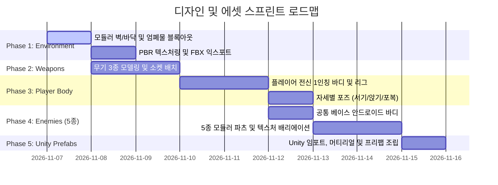

# 3D 디자인 및 에셋 제작 계획서 (`design/plan.md`)

본 문서는 Blender 3D 모델링 및 Unity 연동을 위한 **에셋 제작 상세 작업 목록(WBS)**을 정의합니다.

---

## 작업 진행 현황 요약

---

## 세부 제작 목록 (Checklist)

### Phase 1: 모듈러 환경 & 엄폐물 에셋 (`design/Environment/`)
> 맵 구성의 기본이 되는 조립식 타일 및 엄폐물 프랍

- [ ] **바닥 및 벽 모듈 (4m 그리드)**
  - [ ] `SM_Floor_4x4.blend` (4.0m × 4.0m × 0.2m 기본 바닥 타일)
  - [ ] `SM_Wall_4x3.blend` (4.0m × 0.4m × 3.0m 기본 외벽/내벽)
  - [ ] `SM_Wall_Corner.blend` (1.0m × 1.0m × 3.0m 코너 연결 기둥)
- [ ] **엄폐물 프랍 (규격 엄수, 바닥면 피벗 Z=0)**
  - [ ] `SM_Cover_Half_01.blend` (1.5m × 0.6m × **1.0m** 콘크리트 전술 방호벽 / 앉아서 사격 가능)
  - [ ] `SM_Cover_Full_01.blend` (1.0m × 1.0m × **2.2m** 육각 방탄 기둥 / 완전 은폐 가능)
- [ ] **FBX 익스포트 & Unity 검증**: 그리드 스냅 정합성 및 충돌체(Collider) 확인.

---

### Phase 2: 무기 에셋 3종 (`design/Weapons/`)
> 1인칭 시야각에 노출되는 고품질 무기 및 소켓 세팅

- [ ] **1. `Wep_MachineGun.blend` (돌격 소총/기관총)**
  - [ ] 본체(Body) 및 탈착식 탄창(Magazine) 분리 모델링
  - [ ] 소켓 배치: `Socket_Grip`(손 파지점), `Socket_Muzzle`(총구), `Socket_Ejector`(탄피 배출)
  - [ ] PBR 머티리얼: 무광 밀리터리 금속 질감
- [ ] **2. `Wep_PlasmaCaster.blend` (프레데터식 단발 레이저 캐논)**
  - [ ] 미래형 각진 총신 및 발광형 에너지 코어 모델링
  - [ ] 소켓 배치: `Socket_Grip`, `Socket_Muzzle`
  - [ ] 머티리얼: 어두운 외장 합금 + Emissive(발광) 블루/레드 에너지 셀
- [ ] **3. `Wep_CombatKnife.blend` (전술 단검 / 에너지 나이프)**
  - [ ] 인체공학적 그립 및 칼날(Blade) 모델링
  - [ ] 소켓 배치: `Socket_Grip`
  - [ ] 머티리얼: 카본 파이버 손잡이 + 특수합금 날

---

### Phase 3: 플레이어 1인칭 전신 바디 (`design/Characters/`)
> 아래를 내려다보았을 때 자기 팔다리가 보이는 True First-Person 리그

- [ ] **`SK_Player_FullBody.blend` (플레이어 전신)**
  - [ ] 1인칭 손/팔 고해상도 디테일 (전술 장갑, 전투복 소매)
  - [ ] 몸통(가슴/복부) 및 하체(허벅지, 무릎, 군화) 모델링
  - [ ] 카메라 장착용 본: `Head` (머리 메시는 1인칭 시야 방해 방지용 분리)
  - [ ] 무기 장착 소켓: 오른손 `Socket_Weapon_R`
- [ ] **자세별 기본 포즈/동기화 세팅**
  - [ ] **서기 (Stand)**: 표준 1인칭 전방 자세
  - [ ] **앉기 (Crouch)**: 굽힌 무릎이 시야 하단에 노출되는 자세
  - [ ] **포복 (Prone)**: 바닥에 양팔을 대고 다리를 뒤로 뻗어 엎드린 포즈

---

### Phase 4: 적 캐릭터 5종 (`design/Characters/`)
> 공통 베이스 바디 1종 + 5종 모듈러 파츠 결합

- [ ] **공통 베이스: `CH_Enemy_Base.blend`**
  - [ ] SF 전술 안드로이드 휴머노이드 프레임 (키 1.8m)
  - [ ] 흉부 중앙 발광형 에너지 코어(`Heart_Core`) 모델링 (심장샷 시각 식별용)
  - [ ] 공통 스켈레톤 리그 및 파츠 장착 소켓 정의
- [ ] **원거리 2종**
  - [ ] `CH_Striker`: 전술 흉갑 아머 + 바이저 헬멧 + 소총 파지 리그
  - [ ] `CH_PlasmaHeavy`: 헤비 아머 팩 + 어깨 견착식 캐논 마운트
- [ ] **근거리 3종**
  - [ ] `CH_ScoutRunner`: 경량 프레임 + 유선형 무릎 관절 + 단검 파지
  - [ ] `CH_Bruiser`: 대형 전술 쉴드(방패) + 완충형 어깨 장갑
  - [ ] `CH_Stalker`: 스텔스 위장 텍스처 + 양손 듀얼 블레이드
- [ ] **대형 보스: `CH_Boss_Goliath.blend`**
  - [ ] **3.5m ~ 4.0m 크기의 압도적인 거대 결전 메카 프레임**
  - [ ] 양 어깨 개폐식 8연장 마이크로 미사일 포드 (`Pod_Missile_L/R`)
  - [ ] 흉부 대형 오버차지 플라즈마 빔 렌즈 (`Core_Beam_Emitter`)
  - [ ] 양팔 중장갑 무장: 오른팔 듀얼 헤비 개틀링, 왼팔 지면 강타용 육중한 파쇄 너클
  - [ ] 페이즈 2 광폭화 연출용 추가 발광/부스터 파츠 및 연기 배출구(Exhaust)
- [ ] **텍스처 & 머티리얼**: 역할별 식별 컬러(바이저 발광 색상 등) 부여

---

### Phase 5: 오디오 & 사운드 에셋 (`design/Audio/`)
> 타격감, 공간감, 전술적 피드백을 전달하는 핵심 효과음

- [ ] **1. 무기 효과음 (`Audio/Weapons/`)**
  - [ ] `SFX_Wep_MachineGun_Fire.wav` (기관총 연사/단발 파열음)
  - [ ] `SFX_Wep_MachineGun_Reload.wav` (탄창 분리/결착 철컥음)
  - [ ] `SFX_Wep_Plasma_Charge.wav` (프레데터식 고주파 차징 충전음)
  - [ ] `SFX_Wep_Plasma_Fire.wav` (폭발적 에너지 펄스 발사음)
  - [ ] `SFX_Wep_Knife_Swing.wav` / `_Hit.wav` (단검 공기 가르는 소리 및 타격음)
  - [ ] `SFX_Wep_DryFire.wav` (탄약 소진 시 공이 치는 틱 소리)
- [ ] **2. 이동 및 3단계 자세 효과음 (`Audio/Movement/`)**
  - [ ] `SFX_Move_Step_Stand.wav` (서서 달리기/걷기 발소리)
  - [ ] `SFX_Move_Step_Crouch.wav` (앉아서 천천히 걷는 조용한 발소리)
  - [ ] `SFX_Move_Crawl_Prone.wav` (포복 시 군복과 지면이 바스락 비벼지는 기어가는 소리)
  - [ ] `SFX_Move_Stance_Transition.wav` (서기↔앉기↔포복 전환 시 전술 조끼 장비 쓸림음)
- [ ] **3. 피탄(Impact) & 환경 효과음 (`Audio/Impacts/`, `Audio/Ambience/`)**
  - [ ] `SFX_Impact_Concrete.wav` (벽/엄폐물 콘크리트 튀는 피탄음)
  - [ ] `SFX_Impact_Metal.wav` (금속 기둥/쉴드 도탄 팅 소리)
  - [ ] `SFX_Impact_Flesh.wav` (신체/안드로이드 피격 타격음)
  - [ ] `SFX_Ambience_RoomTone.wav` (긴장감 있는 전장 배경 앰비언스)
- [ ] **4. 적 무전 및 피드백 (`Audio/Voice/`, `Audio/UI/`)**
  - [ ] `SFX_Radio_Chirp.wav` (적 LLM 전술 대사 출력 전 치익 무전 노이즈)
  - [ ] `SFX_UI_Hitmarker.wav` (총알 적중 시 콜오브듀티 스타일 경쾌한 찰칵 소리)
  - [ ] `SFX_UI_Headshot.wav` (헤드샷 치명타 적중 시 맑은 금속성 띵 소리)
  - [ ] `SFX_UI_KillConfirm.wav` (적 처치 확인 묵직한 완료음)

---

### Phase 6: Unity 임포트 & 프리팹 패키징
> 엔진 런타임용 최종 연결

- [ ] `design/`의 각 모델을 `development/Assets/Art/Models/`로 FBX 익스포트
- [ ] Unity 인스펙터에서 Rig = Humanoid 설정 및 소켓 Transform 연결
- [ ] 무기 및 적 캐릭터 프리팹(`.prefab`) 생성 및 콜라이더/히트박스 세팅
