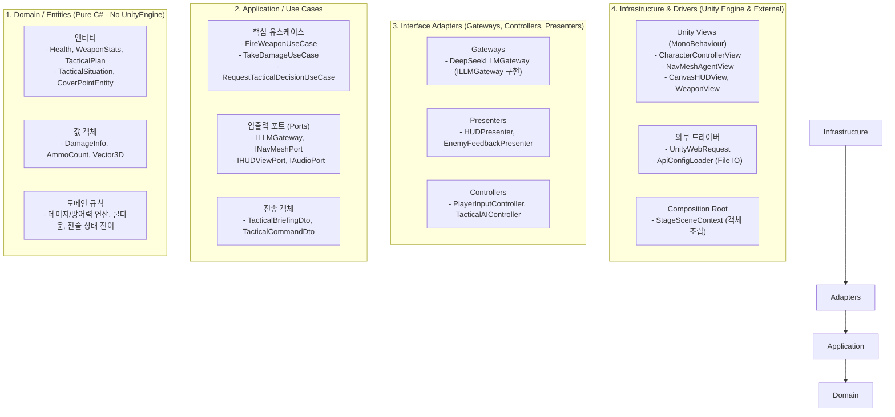
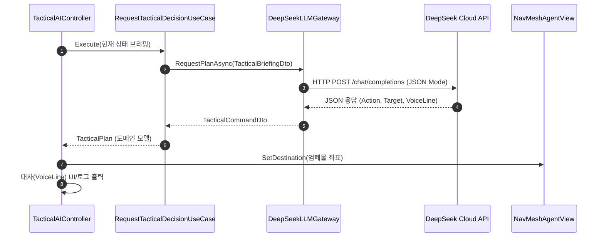
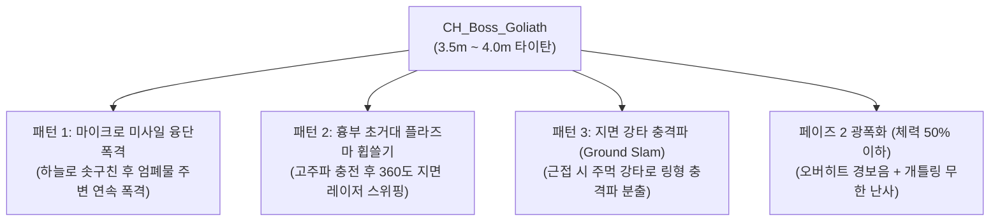

# Unity Clean Architecture 명세서 (`development/ARCHITECTURE.md`)

본 문서는 Unity FPS 프로젝트의 유지보수성, 확장성, 테스트 용이성을 위한 **Clean Architecture 4계층 구조**와 데이터 흐름을 정의합니다.

---

## 1. 아키텍처 개요 및 계층 분리



---

## 2. 계층별 상세 역할 및 컴포넌트

### 1) Domain Layer (`Assets/Scripts/1_Domain/`)
- **특징**: `UnityEngine` 의존성이 전혀 없는 순수 C# (POCO). 단위 테스트가 즉시 가능함.
- **Entities**:
  - `Health`: 현재/최대 체력, 피격, 사망 상태 관리.
  - `WeaponStats`: 사거리, 데미지, 연사 속도, 탄창 크기, 무기 타입(기관총/레이저/단검).
  - `TacticalPlan`: LLM이 결정한 목표 행동(`ActionType`), 목표 지점, 대사, 공격성.
- **Value Objects**:
  - `DamageInfo`: 피해량, 관통력, 타격 부위.
  - `Vector3D`: 엔진 독립적 3차원 좌표 표현.

### 2) Application Layer (`Assets/Scripts/2_Application/`)
- **특징**: 게임의 유스케이스와 시스템 경계 인터페이스(Ports) 정의.
- **Use Cases**:
  - `FireWeaponUseCase`: 잔탄 검사 -> 격발 연산 -> 데미지 대상 판별 -> 잔탄 차감.
  - `TakeDamageUseCase`: 데미지 적용 -> 체력 차감 -> 사망 여부 이벤트 브로드캐스트.
  - `RequestTacticalDecisionUseCase`: 전장 정보 취합 -> `ILLMGateway` 비동기 요청 -> 수신된 전술을 `TacticalPlan`으로 변환.
- **Ports (인터페이스)**:
  - `ILLMGateway`: LLM API 호출 경계.
  - `INavMeshPort`: 길찾기 및 위치 도달 여부 질의/명령 경계.
  - `IHUDViewPort`: UI 갱신 이벤트 전달 경계.

### 3) Interface Adapters Layer (`Assets/Scripts/3_Adapters/`)
- **Gateways**:
  - `DeepSeekLLMGateway`: `ILLMGateway`를 구현하며, DTO를 JSON으로 직렬화/역직렬화하고 타임아웃/예외를 처리.
- **Presenters**:
  - `HUDPresenter`: 도메인 상태(체력, 탄약, 적 대사)를 받아 `IHUDViewPort`로 바인딩.
  - `HitFeedbackPresenter`: 사격 명중 이벤트(일반/헤드샷/처치)를 받아 히트마커 및 타격 사운드 즉각 트리거.
  - `AudioPresenter`: 유스케이스 이벤트(사격, 피격, 자세 전환, 발소리)를 받아 `IAudioPort` 호출.
- **Controllers**:
  - `PlayerInputController`: Unity 입력을 받아 유스케이스 명령으로 변환.
  - `TacticalAIController`: AI 타이머/이벤트에 따라 `RequestTacticalDecisionUseCase` 트리거.

### 4) Infrastructure Layer (`Assets/Scripts/4_Infrastructure/`)
- **Unity Views**:
  - `CharacterControllerView`: 실제 플레이어 이동 및 물리 처리.
  - `NavMeshAgentView`: Unity `NavMeshAgent`를 래핑하여 `INavMeshPort` 구현.
  - `CanvasHUDView`: 실제 UGUI/TextMeshPro 컴포넌트 제어.
  - `AudioServiceView`: Unity `AudioSource`와 3D 공간 음향(Spatial Audio)을 활용해 `IAudioPort` 구현.
- **Composition Root (`StageSceneContext.cs`)**:
  - 씬 시작 시 모든 의존성(인스턴스 생성, 주입, 이벤트 바인딩)을 단 한 곳에서 연결.

---

## 3. 핵심 시퀀스 다이어그램

### LLM 전술 의사결정 흐름



---

## 4. 플레이어 전투 메커니즘 (조준, 사격, 자세 시스템)

### 1) 조준 및 사격 입력 (Aim & Fire)
- **True First-Person 바디 가시화 (Full-Body Awareness)**:
  - 1인칭 시점에서도 플레이어의 손/팔과 들고 있는 무기(기관총/레이저/칼)가 화면 앞쪽에 실시간 표시.
  - 마우스를 아래로 내리면 플레이어 자신의 가슴, 다리, 발이 직접 보임.
  - 특히 **포복(Prone)** 시 바닥에 엎드린 양팔과 다리가 시야각 하단에 기어가는 형태로 노출되어 몰입감 극대화.
- **우클릭 (ADS, Aim Down Sights)**:
  - 카메라 FOV 축소 (정밀 확대 줌)
  - 탄퍼짐 대폭 감소, 반동 억제력 증가, 조준 시 이동 속도 70%로 감속
- **좌클릭 (Fire)**:
  - 장착된 무기(기관총/레이저/단검)의 사격/공격 로직 수행

### 2) 3단계 자세 시스템 (Stance System)
플레이어의 자세는 이동성, 피격 피탄 면적, 명중률(탄착군)에 직접적인 영향을 줍니다.

| 구분 | 서기 (Stand) | 앉기 (Crouch) | 포복 (Prone, 앞으로 엎드리기) |
|:---|:---:|:---:|:---:|
| **조작 키 (기본)** | 기본 상태 | `C` (토글) | `Ctrl` / `Z` (토글) |
| **카메라 시점 높이** | **1.6m** (서서 주변 관측) | **1.0m** (하프 엄폐물 은폐) | **0.35m** (지면 밀착, 풀/턱 은폐) |
| **피격 콜라이더 높이** | 1.8m | 1.1m | 0.45m |
| **이동 속도 비율** | **100%** (기본 주행/점프 가능) | **30%** (매우 신중한 이동, 점프 불가) | **5% ~ 10%** (포복 기어가기, 점프 불가) |
| **탄퍼짐(명중률) 배율** | **1.0x** (기본 분산) | **0.6x** (40% 명중률 향상) | **0.25x** (75% 명중률 향상, 초정밀) |
| **수직/수평 반동 배율** | **1.0x** | **0.7x** | **0.3x** |

### 3) 최종 명중률(탄퍼짐) 도메인 수식
순수 도메인 로직에서 계산되는 탄퍼짐 각도(Spread Angle):
$$\text{FinalSpread} = \text{BaseSpread} \times \text{StanceMultiplier} \times \text{AimMultiplier} \times \text{MovementPenalty}$$

- $\text{StanceMultiplier}$: 서기($1.0$), 앉기($0.6$), 포복($0.25$)
- $\text{AimMultiplier}$: 지향사격($1.0$), 우클릭 정밀조준($0.35$)
- $\text{MovementPenalty}$: 정지($1.0$), 걷기($1.4$), 달리기($2.0$)
- 결과적으로 **[포복 + 우클릭 정밀조준 + 정지]** 상태일 때 레이저/기관총의 집탄율이 극대화됩니다.

---

## 5. 데미지 & 생존 메커니즘 (부위별 타격 및 즉사 방지)

### 1) 플레이어 원샷 보호 시스템 (One-Shot Protection)
플레이어가 억울하게 즉사하지 않고 긴장감 넘치는 역전의 기회를 가질 수 있도록 보호 규칙을 도메인에 적용합니다.

- **즉사 방지 (Death Prevention)**:
  - 플레이어의 체력이 20% 이상 남아있을 경우, 적의 어떤 초고위력 공격(저격, 단발 레이저)을 맞아도 즉사하지 않고 **최소 체력 1로 생존**.
- **무적 윈도우 (Invulnerability Grace Period)**:
  - 원샷 보호 발동 즉시 **0.8초 동안 완전 무적** 부여.
  - 화면 테두리에 붉은 비네트와 함께 심장 박동음(Heartbeat)이 울려 긴급 엄폐를 유도.
- **체력 자동 회복 (Out-of-Combat Regen)**:
  - 엄폐 후 4초 동안 피격당하지 않으면 초당 15씩 체력 자동 회복.

### 2) 상대방 부위별 정밀 타격 시스템 (Locational Damage)
적 안드로이드의 피격 콜라이더를 세분화하여, 정밀 사격(에임)에 대해 압도적인 쾌감과 즉각적인 보상을 부여합니다.

| 피격 부위 (`HitboxType`) | 데미지 효과 | 타격 피드백 & 연출 |
|:---|:---:|:---|
| **헤드샷 (Head)** | **즉사 (One-Hit Kill)** | 굵은 **붉은색 X/해골 히트마커** + 금속성 "띵" 사운드 + 헤드 파츠 파열 즉시 사망 |
| **심장샷 (Heart / Core)** | **즉사 (One-Hit Kill)** | **골드/주황 해골 히트마커** + 묵직한 코어 폭발음 + 가슴 에너지 코어 대폭발 즉시 사망 |
| **일반 몸통 (Body / Torso)** | 1.0x (표준 데미지) | 기본 흰색 히트마커 + 표준 피격 사운드 |
| **팔/다리 사지 (Limbs)** | 0.7x (감쇄 데미지) | 소형 히트마커, 경미한 피해 |

- **도메인 데미지 연산 규칙**:
  ```csharp
  // 보스 몬스터는 원킬 면제 (고배율 치명타로 대체)
  if (target.IsBoss)
  {
      float multiplier = hitbox switch
      {
          HitboxType.Head => 3.0f,       // 보스 헤드샷: 3.0x 데미지 + 경직 게이지 누적
          HitboxType.Heart => 2.5f,      // 보스 심장 코어: 2.5x 데미지 + 쉴드 관통
          HitboxType.Body => 1.0f,
          HitboxType.Limbs => 0.6f,
          _ => 1.0f
      };
      targetHealth.TakeDamage(baseDamage * multiplier, isCritical: (hitbox == HitboxType.Head || hitbox == HitboxType.Heart));
  }
  else
  {
      // 일반 적 5종: 헤드샷 또는 심장샷 적중 시 무조건 원킬 즉사
      if (hitbox == HitboxType.Head || hitbox == HitboxType.Heart)
      {
          targetHealth.KillInstantly(DamageType.CriticalOneHit);
      }
      else
      {
          float finalDamage = baseDamage * GetHitboxMultiplier(hitbox);
          targetHealth.TakeDamage(finalDamage);
      }
  }
  ```

---

## 6. 보스 몬스터 아키텍처 (`BossEntity`)

스테이지 1의 최종 클라이맥스를 장식하는 거대 타이탄급 보스 몬스터 설계입니다.

- **기본 스펙**:
  - 명칭: `CH_Boss_Goliath` (거대 보행 결전병기 메카)
  - 크기: 일반 적(1.8m)의 2배가 넘는 **3.5m ~ 4.0m 규모의 압도적인 거체**
  - 환경 연출: 보스 보행 시 지면 진동(Camera Shake) 및 묵직한 중저음 발소리
  - 방어 특성: **원샷 킬 면제(Immune to One-Hit Kill)**, 2페이즈 체력 및 전술 패턴

### 1) 보스의 요란하고 파괴적인 3대 공격 패턴
단순한 총격전을 넘어 전장을 뒤흔드는 화려하고 요란한 연출을 부여합니다.



1. **마이크로 미사일 융단 폭격 (Micro-Missile Barrage)**:
   - 어깨 미사일 포드가 열리며 8~12발의 유도 미사일이 하늘로 솟구친 뒤 플레이어 엄폐물 주변으로 쾅쾅쾅 연속 폭격.
2. **흉부 초거대 플라즈마 휩쓸기 (Sweeping Death Beam)**:
   - 흉부 아크 코어가 2초간 웅장한 고주파음과 함께 차징된 후, 지면을 좌우로 가로지르는 굵은 파괴 광선을 발사. (포복으로 지면에 엎드려야 회피 가능!)
3. **지면 강타 충격파 (Ground Slam Shockwave)**:
   - 플레이어가 근접하거나 기습할 경우 육중한 기계 주먹으로 지면을 내리찍어 전방위 충격파를 발생시킴.
4. **페이즈 2 광폭화 (체력 50% 이하 오버히트 모드)**:
   - 붉은 경보 사이렌과 함께 외장 장갑이 붉게 달아오르며, 듀얼 개틀링 건을 쉬지 않고 난사해 전장을 벌집으로 만듦.

### 2) 보스 공략 약점 메커니즘
- **헤드 바이저**: 3.0x 데미지 누적 시 일시적 다운(Groggy/Stun) 상태 유발.
- **흉부 중앙 오버차지 코어 (Heart)**: 2.5x 데미지 부여 및 보스 방어막(Energy Shield) 급속 파괴.
- **LLM 보스 전술 AI**:
  - 압도적인 위압감의 사령관 보이스 출력 ("전 화력 기동, 전장을 불태워라!", "장갑 50% 손상, 리미터 해제... 전원 섬멸한다!")


