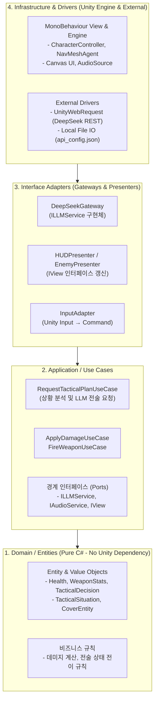

# FPS 게임 프로토타입 개발 가이드 (`development`)

본 프로젝트는 **클라우드 LLM(DeepSeek) 기반의 전술 적 AI**가 적용된 FPS 1개 스테이지 수직 슬라이스(Vertical Slice) 프로토타입입니다. 유지보수성과 확장성을 위해 **Clean Architecture** 원칙에 따라 설계되었습니다.

---

## 1. 아키텍처 개요 (Clean Architecture)

Unity 엔진 의존성(`MonoBehaviour`, 프레임 라이프사이클)과 비즈니스 로직을 명확히 분리하여, 순수 도메인 로직의 독립성과 테스트 용이성을 보장합니다.



---

## 2. 폴더 구조 및 계층별 책임

```text
Assets/Scripts/
├── 1_Domain/                  # 순수 C# (UnityEngine 의존성 없음)
│   ├── Entities/              # Health, TacticalDecision, TacticalSituation
│   ├── ValueObjects/          # DamageInfo, AmmoCount, Vector3D
│   └── Interfaces/            # IDamageable, ITacticalState
│
├── 2_Application/             # 유스케이스 및 인터페이스 포트
│   ├── UseCases/              # RequestTacticalPlanUseCase, FireWeaponUseCase, TakeDamageUseCase
│   ├── Ports/                 # ILLMService, IInputPort, INavMeshPort, IHUDView
│   └── DTOs/                  # TacticalRequestDto, TacticalResponseDto
│
├── 3_Adapters/                # 변환기 및 어댑터
│   ├── Gateways/              # DeepSeekLLMGateway (ILLMService 구현)
│   ├── Presenters/            # HUDPresenter, EnemyDialogPresenter
│   └── Controllers/           # PlayerInputController, TacticalAIController
│
└── 4_Infrastructure/          # Unity Engine 의존 코드
    ├── UnityViews/            # CharacterControllerView, NavMeshAgentView, CanvasHUDView
    ├── Config/                # ApiConfigLoader (api_config.json 로드)
    └── Composition/           # SceneContext (의존성 조립 및 DI Root)
```

---

## 3. LLM 전술 AI 시스템 (DeepSeek)

- **하이브리드 계층형 구조**:
  - **고수준 전술 (LLM)**: 상황 브리핑(체력, 거리, 엄폐물)을 전달받아 전술 지침(엄폐, 우회, 돌격 등) 및 대사를 JSON 형태로 반환.
  - **저수준 물리 이동 (Unity)**: `NavMeshAgent`가 경로 탐색 및 충돌 회피를 실시간 처리.
- **보안 원칙**:
  - API Key는 소스코드에 하드코딩하지 않습니다.
  - 프로젝트 루트의 `api_config.json`(Git 무시 대상) 또는 환경변수 `DEEPSEEK_API_KEY`에서 주입받습니다.

---

## 4. 단계별 개발 마일스톤

| 단계 | 목표 | 주요 산출물 |
|:---:|:---|:---|
| **Phase 1** | **도메인 & 유스케이스 코어 정의** | 순수 C# 엔티티, 유스케이스, 포트 인터페이스 |
| **Phase 2** | **인프라 어댑터 구축 (DeepSeek API)** | `ILLMService` 구현체, API 설정 로더, JSON 파서 |
| **Phase 3** | **Unity 엔진 뷰 & 컨트롤러 구현** | `CharacterControllerView`, `NavMeshAgentView`, 입출력 어댑터 |
| **Phase 4** | **스테이지 조립 & 레벨 배치** | 엄폐물 큐브, 스폰 포인트, NavMesh 베이킹, DI Root 바인딩 |
| **Phase 5** | **HUD 피드백 & 통합 검증** | 적 전술/대사 실시간 시각화, 전투 루프 및 플레이 검증 |
