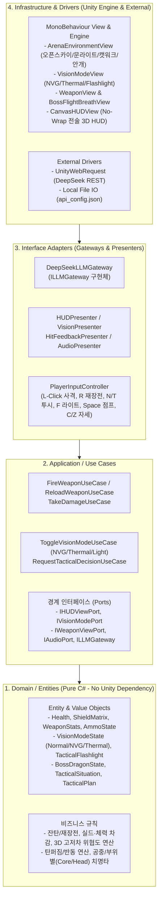

# FPS 게임 프로토타입 개발 가이드 (`development`)

본 프로젝트는 **Unity 6.3.8 (URP)** 환경에서 **`sample.md` (`PROJECT: TARTARUS / OMEGA PROTOCOL`)** 컨셉의 **3D 다층 수직 오픈스카이 아레나(`SEC-04 EXCAVATION CRATER`, 2층 캣워크/저격 타워, 생체비행 드래곤 보스 `ARCHDREADRAZE`, 펄스 카빈/무기군, 야간투시/열화상/택티컬 라이트, 사이버네틱 HUD)**과 **클라우드 LLM(DeepSeek) 기반 전술 적 AI**를 결합한 FPS 수직 슬라이스(Vertical Slice) 프로토타입입니다. 유지보수성과 확장성을 위해 **Clean Architecture** 원칙에 따라 설계되었습니다.

---

## 1. 아키텍처 개요 (Clean Architecture)

Unity 엔진 의존성(`MonoBehaviour`, 렌더링, UI, 프레임 라이프사이클)과 비즈니스 로직을 명확히 분리하여, 순수 도메인 로직의 독립성과 테스트 용이성을 보장합니다.



---

## 2. 폴더 구조 및 계층별 책임

```text
Assets/Scripts/
├── 1_Domain/                  # 순수 C# (UnityEngine 의존성 없음)
│   ├── Entities/              # Health, ShieldMatrix, WeaponStats, BossDragonEntity, TacticalPlan
│   ├── ValueObjects/          # DamageInfo, AmmoState, VisionModeType, ThreatProximityInfo, Vector3D
│   └── Services/              # SpreadCalculator, RecoilPattern, HeadBobCalculator, ThreatEvaluator
│
├── 2_Application/             # 유스케이스 및 인터페이스 포트
│   ├── UseCases/              # FireWeaponUseCase, ReloadWeaponUseCase, ToggleVisionModeUseCase,
│   │                          # ToggleFlashlightUseCase, TakeDamageUseCase, RequestTacticalDecisionUseCase
│   ├── Ports/                 # IHUDViewPort, IVisionModePort, IWeaponViewPort, IAudioPort, ILLMGateway
│   └── DTOs/                  # TacticalRequestDto, TacticalResponseDto, TelemetryStatusDto
│
├── 3_Adapters/                # 변환기 및 어댑터
│   ├── Gateways/              # DeepSeekLLMGateway (ILLMGateway 구현)
│   ├── Presenters/            # HUDPresenter, VisionModePresenter, HitFeedbackPresenter, AudioPresenter
│   └── Controllers/           # PlayerInputController, TacticalEnemyAIController
│
└── 4_Infrastructure/          # Unity Engine 의존 코드
    ├── UnityViews/            # ArenaEnvironmentView, VisionPostProcessView, WeaponView,
    │                          # DragonFlightBreathController, CharacterControllerView, CanvasHUDView
    ├── Config/                # ApiConfigLoader (api_config.json 로드)
    └── Composition/           # Stage1SceneContext (의존성 조립 및 DI Root)
```

---

## 3. 핵심 3D 입체 환경 & 전술 시스템 명세

### 1) 3D 수직 오픈스카이 아레나 & 비전 모드 (`SEC-04 EXCAVATION CRATER`)
- **개방형 3D 다층 지형**: 상공이 열린 거대 분화구 지면(8×8m 모듈), 2층 공중 캣워크(6m) 및 연결 계단(4m), 30도 접근 램프, 팔각형 저격 타워(8m), 오픈 트러스 아치 골조.
- **라이팅 & 스카이박스**: 외계 행성 상공 문라이트(Moonlight), 바닥 지수 안개(`FogExp2`, `#020408`), 캣워크 시안 LED 유도 스트립(`#06b6d4`), 보스 강하 경보 적색 점멸등(`#ff1e1e`), 플레이어 총기 부착 택티컬 스팟라이트(`#cffafe`).
- **3D 입체 전투 메커니즘**:
  - **수직성(Verticality)**: 2층 캣워크 및 타워를 통한 상하 사격각 확보, 난간 하프 엄폐를 활용한 고지대 방어.
  - **공중 결전 보스전**: 비행형 메카 드래곤(`CH_Boss_ArchDreadRaze`)이 열린 상공에서 활공하며 급강하 및 전방위 플라즈마 브레스 폭격 수행.
- **전술 투시 모드 전환 (`N` / `T` / `F` 키 및 하단 HUD 버튼 연동)**:
  - **야간투시 (`NVG`, `N` 키)**: 그린 나이트비전 오버레이(`#12ff6e`) 및 다크 그린 안개(`#063311`).
  - **열화상 (`Thermal`, `T` 키)**: 오렌지/바이올렛 열원 강조 오버레이 및 다크 바이올렛 안개(`#19082b`).
  - **택티컬 라이트 (`F` 키)**: 총열 하단 고광량 손전등 On/Off 토글.

### 2) 사이버네틱 HUD & 텍스트 잘림/세로 줄바꿈 방지 설계
- **상단 바 (Top Bar)**:
  - **좌측 작전 텔레메트리**: `SEC-04 EXCAVATION`, `REC [00:41:19]`, `O2: 97.4% | TEMP: -4.2°C | RAD: 14 mSv/h`, `ATMOSPHERE: CONTAMINATED / BIO-HAZARD L-4`.
  - **중앙 디지털 나침반**: 마우스 조준 각도에 실시간 반응하는 방위각(`NW 315 | N 004° | 045 NE`) 및 `TARGET: SPECIMEN-09 EXTERMINATION`.
  - **우측 근접 위협 경보**: `PROXIMITY ALERT : CRITICAL`, 5단 분할 위협 게이지, 실시간 괴수 거리(`HOSTILE TARGET / DIST: 14.2 M`).
- **중앙 조준기 (Center Reticle)**:
  - 시안 이중 회전 링, 4방향 시안 브래킷, 사격 시 확장 펄스, 적색 타깃 락 코너 브래킷 + `LOCKED: BIOTITAN // HOSTILE`.
- **하단 바 (Bottom Bar - 글자 세로 깨짐·잘림 원천 차단)**:
  - **하단 좌측**: `SHIELD MATRIX (85%)` 시안 바, `VITALITY (100%)` 에메랄드 바, `BATTERY: 98% | STAMINA: OPTIMAL`.
  - **하단 중앙**: 클릭 가능한 5종 전술 컨트롤 버튼(`[사격 FIRE]`, `[재장전]`, `[야간투시]`, `[열화상]`, `[택티컬 라이트]`) 및 키보드/마우스 조작 가이드 레전드.
  - **하단 우측**: 360도 스윕 라인이 회전하는 **30M 미니맵 레이더**(플레이어 시안 도트 & 몬스터 적색 블립) + **펄스 카빈 탄약 매트릭스**(`PULSE CARBINE / FULL-AUTO`, `36 / 45`, 잔탄 바, `MAG: 4/4 | TYPE: KINETIC-PL`).
  - **UI 텍스트 보호 규칙**: 샘플 화면에서 창 폭이 좁을 때 버튼 텍스트가 세로로 꺾이거나 잘리던 현상을 막기 위해, 모든 UI 텍스트에 **`TextWrappingMode.NoWrap`(단일 행 고정)**과 **`ContentSizeFitter` 가변 가로 폭 + 최소 패딩**을 적용하여 실제 화면에서는 모든 한글/영문 문구가 한 줄로 깔끔하게 출력됩니다.

---

## 4. 단계별 개발 마일스톤

| 단계 | 목표 | 주요 산출물 |
|:---:|:---|:---|
| **Phase 1** | **도메인 & 유스케이스 코어 정의** | 순수 C# 엔티티(체력/실드/탄약/비전/위협도), 유스케이스, 포트 인터페이스 |
| **Phase 2** | **지하 복도 환경 & 다크 호러 라이팅 구축** | 60m 복도 모듈, 다크 네이비 안개, 적색 비상 점멸등, 시안 네온, 택티컬 라이트 |
| **Phase 3** | **펄스 카빈 & 바이오타이탄(Specimen-09) 구현** | 1인칭 무기(홀로그램 탄약창/반동/머즐플래시), 생체 코어 발광 괴수 & 포자 미스트 |
| **Phase 4** | **사이버네틱 HUD (No-Wrap) & 비전 모드 연동** | 상/중/하단 HUD 전체, 30M 회전 레이더, NVG/열화상 오버레이, 합성 효과음 |
| **Phase 5** | **LLM 전술 AI 연동 & 통합 플레이 검증** | DeepSeek 전술 게이트웨이, 부위별 타격, UI 레이아웃 무결성(잘림 0건) 검증 |
