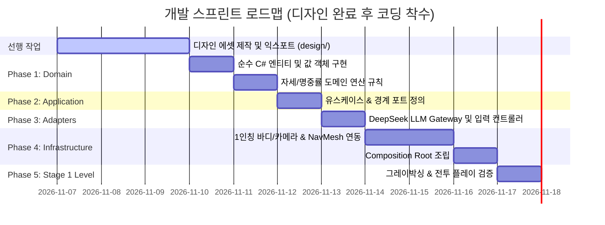

# 개발 작업 계획서 (`development/plan.md`)

본 문서는 Unity FPS 프로젝트의 **Clean Architecture 기반 코딩 및 스테이지 1 구축 작업 목록(WBS)**을 정의합니다.

---

## 작업 진행 현황 요약

> **현재 진행 방향**: 디자인(Blender) 에셋 작업을 먼저 완료한 후 Clean Architecture 코딩 단계로 진입합니다. (현재 코드는 완전 초기화 상태)

---

## 세부 작업 목록 (Checklist)

### Phase 1: Domain Layer (순수 C# - `Assets/Scripts/1_Domain/`)
> Unity 엔진 의존성이 없는 핵심 비즈니스 로직 및 수치 규칙

- [ ] **자세 & 이동 도메인**
  - [ ] `PlayerStance.cs` (Stand, Crouch, Prone 열거형)
  - [ ] `StanceModifier.cs` (이동 속도 100% / 30% / 5~10%, 카메라/콜라이더 높이, 피격 계수)
  - [ ] `SpreadCalculator.cs` (자세 × 조준ADS × 이동속도에 따른 탄퍼짐 및 반동 도메인 연산식)
- [ ] **무기 & 전투 도메인**
  - [ ] `WeaponType.cs` (MachineGun, PlasmaCaster, CombatKnife)
  - [ ] `WeaponStats.cs` (데미지, 사거리, 연사 속도, 탄창 크기, 기본 탄퍼짐)
  - [ ] `HitboxType.cs` (Head, Heart, Body, Limbs)
  - [ ] `DamageInfo.cs` (피해량, 피격 부위 HitboxType, 관통 여부 값 객체)
  - [ ] `Health.cs` (체력 관리, 플레이어 원샷 보호 OSP 로직 및 무적 윈도우)
  - [ ] `BossEntity.cs` (보스 체력, 2페이즈 전환, 원킬 면제 및 약점 배율 로직)
  - [ ] `BossAttackPatternUseCase.cs` (미사일 융단폭격, 흉부 레이저 휩쓸기, 지면 강타 충격파 패턴 제어)
  - [ ] `HealthRegenService.cs` (엄폐 시 비전투 체력 자동 재생)
- [ ] **AI 전술 도메인**
  - [ ] `TacticalSituation.cs` (플레이어 거리, 체력, 주변 엄폐물 목록 데이터)
  - [ ] `TacticalPlan.cs` (행동 타입 TAKE_COVER/FLANK/CHARGE, 목표 좌표, LLM 대사)

---

### Phase 2: Application Layer (유스케이스 및 포트 - `Assets/Scripts/2_Application/`)
> 시스템 경계 및 비즈니스 흐름 제어

- [ ] **유스케이스 (Use Cases)**
  - [ ] `FireWeaponUseCase.cs` (사격 요청 -> 잔탄 검증 -> 격발 -> 데미지 처리)
  - [ ] `TakeDamageUseCase.cs` (피격 처리 -> 체력 차감 -> 사망 브로드캐스트)
  - [ ] `ChangeStanceUseCase.cs` (서기/앉기/포복 전환 및 공간 검증)
  - [ ] `SetAimStateUseCase.cs` (지향사격 ↔ 우클릭 정밀 조준 ADS 전환)
  - [ ] `RequestTacticalDecisionUseCase.cs` (상황 취합 -> LLM 전술 요청 -> 목표 플랜 도출)
- [ ] **포트 인터페이스 (Ports)**
  - [ ] `ILLMGateway.cs` (LLM 비동기 통신 경계)
  - [ ] `INavMeshPort.cs` (AI 이동 및 경로 탐색 제어 경계)
  - [ ] `IHUDViewPort.cs` (크로스헤어, 체력/탄약, 적 대사 갱신 이벤트 경계)
  - [ ] `IWeaponViewPort.cs` (머즐 플래시, 반동 애니메이션, 총기 사운드 경계)
  - [ ] `IAudioPort.cs` (3D 공간 효과음, 발소리, 사격음, 피탄음 재생 경계)

---

### Phase 3: Interface Adapters (`Assets/Scripts/3_Adapters/`)
> 데이터 변환 및 외부-내부 매개

- [ ] **게이트웨이 (Gateways)**
  - [ ] `DeepSeekLLMGateway.cs` (REST API 호출, JSON DTO 역직렬화, 타임아웃/오류 시 Fallback 전술)
- [ ] **컨트롤러 (Controllers)**
  - [ ] `PlayerInputController.cs` (WASD, 마우스 룩, 좌클릭 사격, 우클릭 ADS, C/Ctrl/Z 자세 입력)
  - [ ] `TacticalEnemyAIController.cs` (주기적/피격 시 전술 유스케이스 트리거 및 NavMesh 명령 전달)
- [ ] **프레젠터 (Presenters)**
  - [ ] `HUDPresenter.cs` (플레이어 상태 및 크로스헤어 탄퍼짐 실시간 시각화)
  - [ ] `HitFeedbackPresenter.cs` (명중 시 X자 히트마커, 헤드샷 붉은 마커, 찰칵 적중음, 적 백색 점멸 제어)
  - [ ] `AudioPresenter.cs` (사격/피격/자세변경/발소리 이벤트를 오디오 포트로 라우팅)
  - [ ] `EnemyFeedbackPresenter.cs` (적의 현재 전술 생각 및 대사를 UI/월드 공간에 출력)

---

### Phase 4: Infrastructure Layer (`Assets/Scripts/4_Infrastructure/`)
> Unity 엔진 컴포넌트 구현 및 의존성 주입

- [ ] **플레이어 뷰 (Player Views)**
  - [ ] `FirstPersonBodyView.cs` (True First-Person 바디 리그 제어, 머리 컬링, 마우스 Pitch/Yaw)
  - [ ] `CharacterControllerView.cs` (CharacterController를 통한 3단계 자세 높이/이동속도 Lerp)
- [ ] **무기 & AI 뷰 (Views)**
  - [ ] `WeaponView.cs` (1인칭 손/무기 렌더링, 우클릭 ADS 줌 Lerp, 발사 이펙트)
  - [ ] `NavMeshAgentView.cs` (Unity NavMeshAgent를 래핑하여 INavMeshPort 구현)
  - [ ] `HitboxPartView.cs` (Head, Heart, Body, Limbs 부위별 독립 콜라이더 및 피격 라우팅)
  - [ ] `BossVFXView.cs` (마이크로 미사일 투사체, 흉부 레이저 스위핑 빔, 지면 강타 충격파 링 이펙트)
  - [ ] `CanvasHUDView.cs` (TextMeshPro 기반 HP, 탄약, 적 대사, 크로스헤어 UI, **상단 보스 체력바**)
  - [ ] `AudioServiceView.cs` (Unity AudioSource 풀링 및 3D 공간 음향 재생기)
- [ ] **설정 & Composition Root**
  - [ ] `ApiConfigLoader.cs` (`api_config.json` 안전 로더)
  - [ ] `Stage1SceneContext.cs` (씬 시작 시 모든 계층 객체 생성 및 의존성 단일 조립)

---

### Phase 5: Stage 1 Level & 통합 검증
> 1개 스테이지 맵 배치 및 완성도 테스트

- [ ] **스테이지 그레이박싱**
  - [ ] 4m 단위 바닥 및 외벽 배치
  - [ ] 하프 엄폐물(1.0m) 6~8개, 풀 엄폐물(2.2m) 4개 전술적 배치
  - [ ] 플레이어 스폰 포인트 및 적 5종 스폰 지점 설정
  - [ ] Unity NavMesh 베이킹
- [ ] **전투 루프 통합 테스트**
  - [ ] 플레이어 서기/앉기/포복 및 우클릭 조준 동작 검증
  - [ ] 무기 3종(기관총/레이저/단검) 사격 및 탄퍼짐 수치 검증
  - [ ] 적 5종의 LLM 전술(엄폐, 우회, 돌격) 실시간 반응 검증
